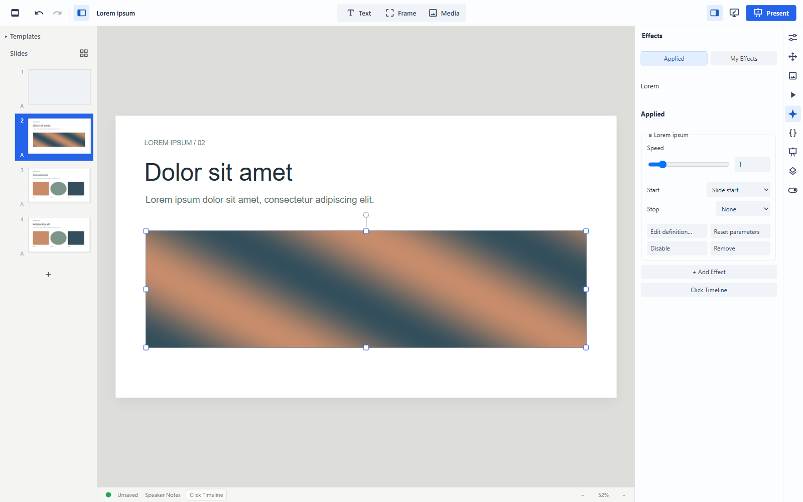
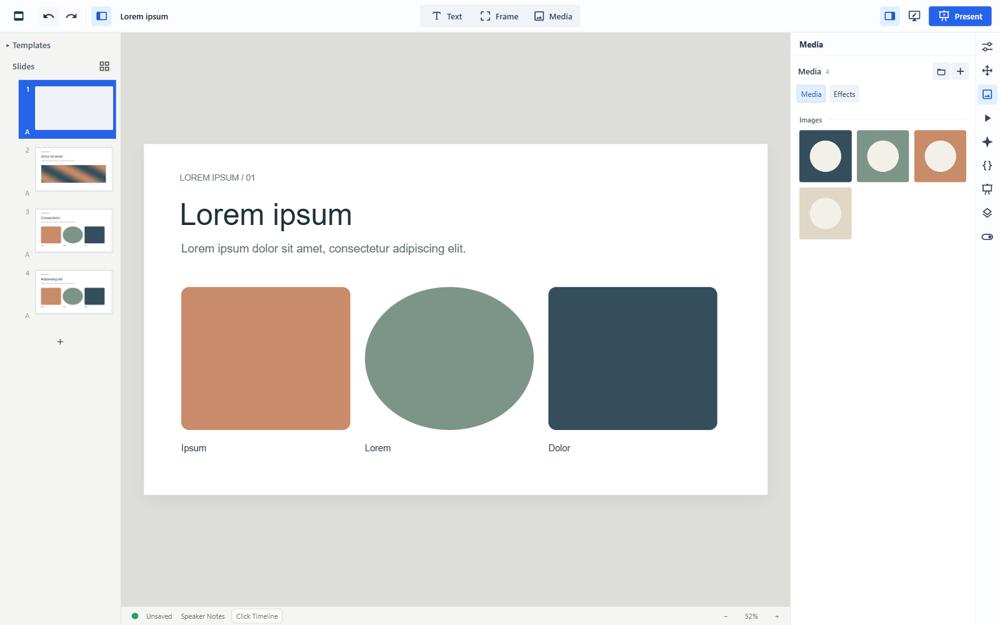

# ShowMe

ShowMe is a desktop presentation editor for macOS and Windows.
It uses web technologies and supports programmable visual effects, reusable presentation assets, and local presentation files.


## Features

- CSS, JavaScript and GLSL shader effects
- Central asset library with deduplication across presentations
- Motion, Click Timeline, slide transitions and presenter tools
- Reusable Text Styles and Templates
- Portable `.smp` presentations and managed `.sme` projects
- PowerPoint import/export and PDF export
- Local-first desktop app for macOS and Windows
- Experimental LAN collaboration

## Effects

Elements can use CSS, JavaScript and GLSL fragment shaders. Effects can use continuous time, Click Timeline progress, or both.




## Motion and Click Timeline

Motion handles element animation. Click Timeline arranges actions into presentation steps; continuous Effects can remain independent of clicks.


## Assets

The managed asset library uses content-addressed assets and deduplicates the same asset across presentations.



## Text Styles and Templates

Text Styles provide presentation-wide typography with local overrides. Templates provide shared slide structure.


## Presenter

The presenter console shows the current slide, next slide, speaker notes and playback controls.


## Installation

This is a source-only release. Use Node.js 24 or 26, as specified in `package.json`.

```bash
git clone https://github.com/KonradJuenger/ShowMe.git
cd ShowMe
npm ci
npm run desktop
```

`npm run desktop` builds the app and launches Electron. For browser development with Vite, run `npm run dev`.

To build the renderer and Electron application without launching:

```bash
npm run build
```

## Files

`.sme` uses ShowMe's managed asset library. `.smp` is a portable presentation package.

Fonts are normally not embedded. Typography may differ on another machine if the same fonts are unavailable.

## Collaboration

LAN collaboration is experimental. It is intended for trusted local networks and the connection is not encrypted.

## Status

v0.1.0 — source release. There are currently no official binaries or installers.

## License

[AGPL-3.0-or-later](LICENSE).
