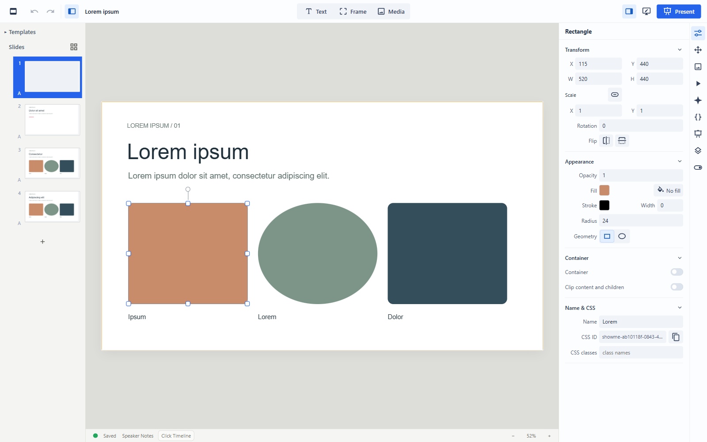
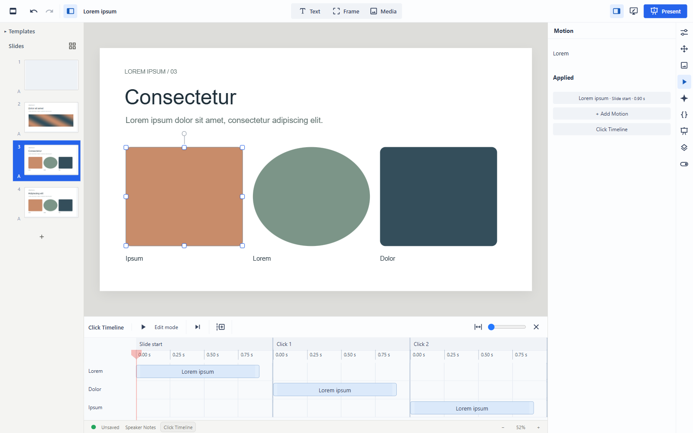
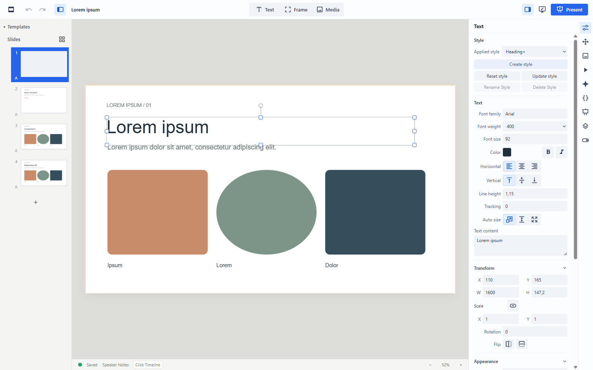
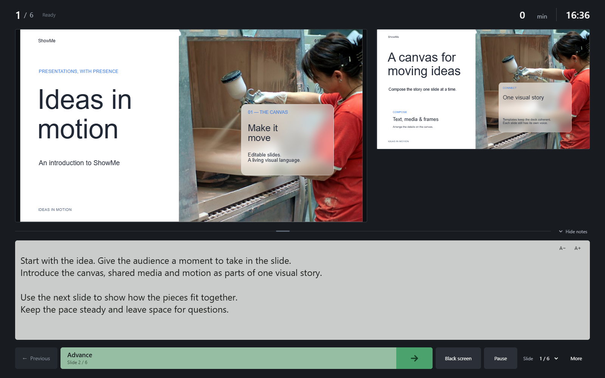
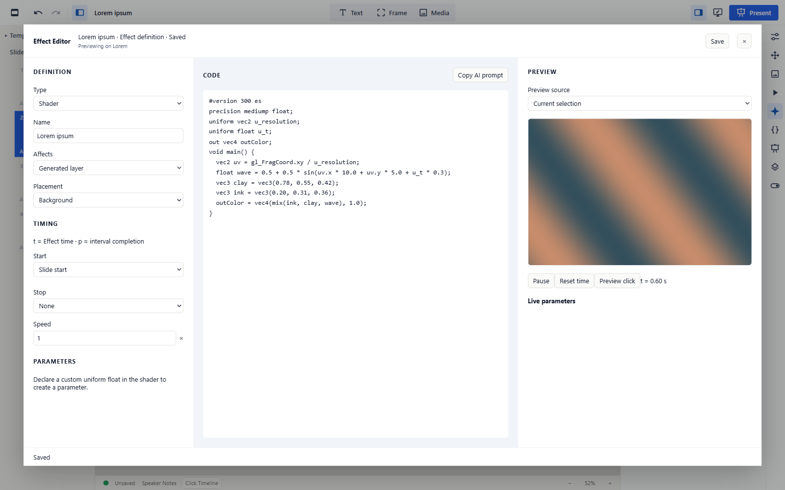

# ShowMe

ShowMe is an open-source presentation editor for macOS and Windows. It runs
locally and stores presentations and media on your computer. It does not require
an account, a cloud service or a subscription.

It has a shared media library, a visual slide editor, an animation timeline and
a presenter view. CSS, JavaScript and GLSL effects are also supported.



## Shared media library

Images and videos are stored in a central local library and can be used in
multiple presentations. Imports are checked by content, so identical assets
already in the library are reused across presentations that share it.

The library supports folders, previews and dragging media onto slides. Unused
assets can be moved to Trash, and assets can be protected from cleanup.

## Slide editing

Text, images, video and frames are arranged on a canvas. Editing tools include
layers, groups, snapping, guides and rulers. Media can fit or fill a frame, or
be positioned freely within it. Video controls include looping and muting.

Presentations support sections, slide transfer and custom slide dimensions.

## Animation and timeline

Motion library provides element animation with keyframes and easing. The Click Timeline
organizes actions into steps advanced during a presentation. It also controls
when objects appear and disappear. Slide transitions are supported.



## Text Styles and Templates

Text Styles define shared typography within a presentation, with local
overrides. Templates define slide structure used by multiple slides.



## Presenter console

The presenter console shows the current slide, next slide, speaker notes,
elapsed time and playback controls. Audience output can be assigned to a
connected screen.



## Files and export

Presentations can be created, edited and presented offline. You choose where
the ShowMe folder is stored and how to back it up or synchronize it.

- Managed `.sme` presentations reference the shared media library. Keep them
  below the ShowMe root so library cleanup can find their asset references.
- Portable `.smp` packages contain a presentation and its media for transfer to
  another computer.

ShowMe can import and export PowerPoint files and export PDF. PowerPoint export
does not preserve ShowMe Motion, object appearance timing or slide transitions,
and has limitations for custom browser styling.

Fonts are normally not embedded in ShowMe packages. Typography may differ on
another computer if the same fonts are unavailable.

Local recovery records edits for recovery after an interrupted session.

## Web effects

Elements can use CSS, JavaScript and GLSL fragment shaders. Effects have a live
preview and can be saved in the library for reuse. They can run continuously,
follow Click Timeline progress, or use both.



## Installation

This is a source release. There are currently no official binaries or installers.
Use Node.js 24 or 26, as specified in `package.json`.

```bash
git clone https://github.com/KonradJuenger/ShowMe.git
cd ShowMe
npm ci
npm run desktop
```

`npm run desktop` builds the app and launches Electron. For browser development with Vite, run `npm run dev`.

To build the renderer and Electron application without launching:

```bash
npm run build
```

## Build downloadable apps

The **Build binaries** GitHub Actions workflow packages Mac Intel (`x64`),
Mac Apple Silicon (`arm64`), and Windows (`x64`) apps on native runners.
Open **Actions → Build binaries → Run workflow** in your GitHub repository
and select the branch to build. After it finishes, download the matching artifact
from the workflow run's **Artifacts** section. Each file is a separate download,
without an extra ZIP wrapper, and its filename includes the version and architecture.

- Each Mac architecture has a separate DMG and ZIP. Open the DMG and drag ShowMe into Applications.
- Windows has a separate installer EXE and portable EXE.

These builds use the version in `package.json` (currently `0.1.0`); all platforms
share that version. To set a new version, run
`npm version 0.1.1 --no-git-tag-version` and commit both package files before building.

Mac builds are ad-hoc signed and not notarized. On first launch, macOS may require
**System Settings → Privacy & Security → Open Anyway**. Windows builds are unsigned.
The workflow retains downloads for 30 days and does not publish a GitHub Release.
The separate **Desktop verification** workflow runs the full release checks.

## Collaboration

LAN collaboration is experimental. It is intended for trusted local networks and the connection is not encrypted.

Collaboration synchronizes presentation edits, not filesystem contents. Sync the complete ShowMe root, including `ShowMe Library/` and every `.sme` presentation that uses it, for example with Syncthing. Each computer selects its local copy of that same root; absolute paths can differ. Keep native presentations anywhere below the root so Library cleanup scans the complete set. Missing media is shown as a placeholder and updates when the asset becomes available locally.

## Local MCP integration

ShowMe includes an experimental local MCP server for agents running on your computer.
Open **Settings → MCP · Experimental**, enable MCP, then use **Copy for Codex (TOML)**,
**Copy for MCP clients (JSON)** or **Copy for VS Code (JSON)** to connect a stdio
MCP host. Each action copies a complete server entry for that format. Node.js 24 or 26
is required; restart or reconnect the host after configuration changes.

Server 1.10 exposes eight tools: `showme.workspace`, `showme.context`,
`showme.authoring`, `showme.inspect`, `showme.measure_text`, `showme.apply`,
`showme.deliver` and `showme.preview`. Agents can inspect accepted unsaved state,
measure text with production fonts, capture sampled production slide PNGs and,
with **Allow agent editing** enabled, create/open presentations, import managed assets,
author content and save/package through the editor's existing document authority.

The semantic authoring surface includes slides, layers, text and Text Styles,
shapes, Frames, hierarchy, alignment/distribution, managed image/SVG/video assets,
media crop/frame controls, transitions, deck CSS, Effects, Motion and Presence.
Persistent geometry stays parent-local, and previews use ShowMe's production renderer.
Media insertion accepts existing ShowMe-managed asset IDs, rather than file paths
or raw bytes. `showme.workspace` can import files through native pickers or supplied
paths inside the user-selected ShowMe root. Imports use production raster/SVG/video
preparation and report partial results when interrupted.

Edits use a separate Agent history so human Ctrl+Z remains independent. Both MCP and
agent editing are off by default. Editing currently requires a locally owned document;
collaboration guest writes and arbitrary filesystem access remain outside the MCP boundary.
ShowMe does not connect to external MCP services.

Protocol discovery contains static capabilities; context reports live state. Selected
operation schemas remain exact, and full server-side validation still runs behind the
compact advertised apply schema. Measured schema/response byte reductions do not
establish model-token savings; fresh-host token and cache behavior remain unverified.

See [local MCP setup and supported operations](docs/mcp/LOCAL_SETUP.md) for connection,
retry and recovery instructions, [the authoring capability matrix](docs/mcp/AUTHORING_CAPABILITY_MATRIX.md)
for editor parity, and [MCP development status](docs/mcp/README.md) for implementation
details and pending evaluation.

## Development

[AGENTS.md](AGENTS.md) describes the development workflow.
[tests/README.md](tests/README.md) describes the test groups and how to run them.
[Are we slow yet?](areweslowyet.md) tracks audience rendering benchmarks by commit.

## License

[AGPL-3.0-or-later](LICENSE).
