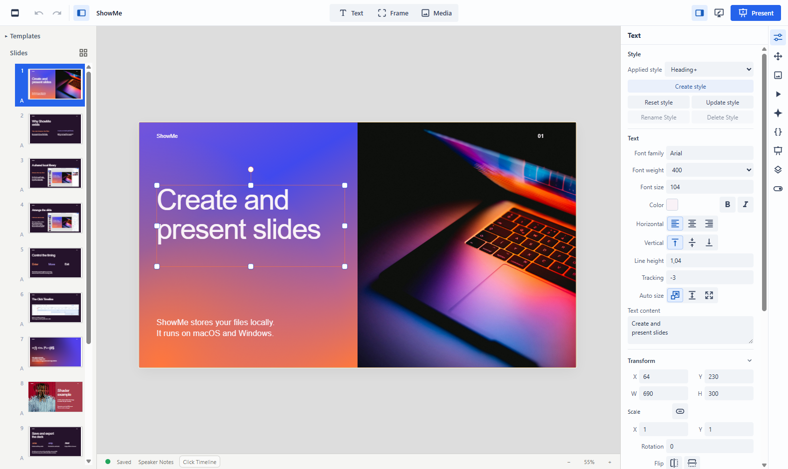
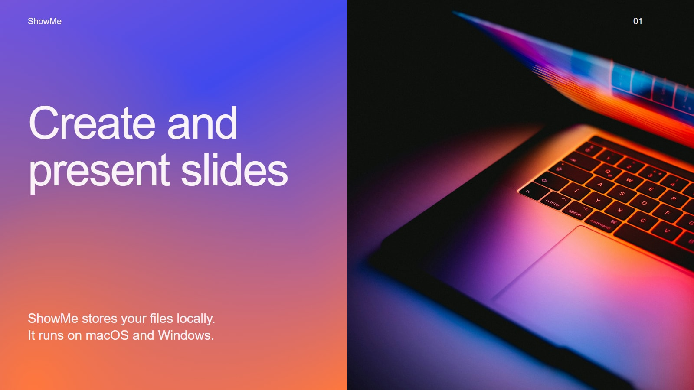
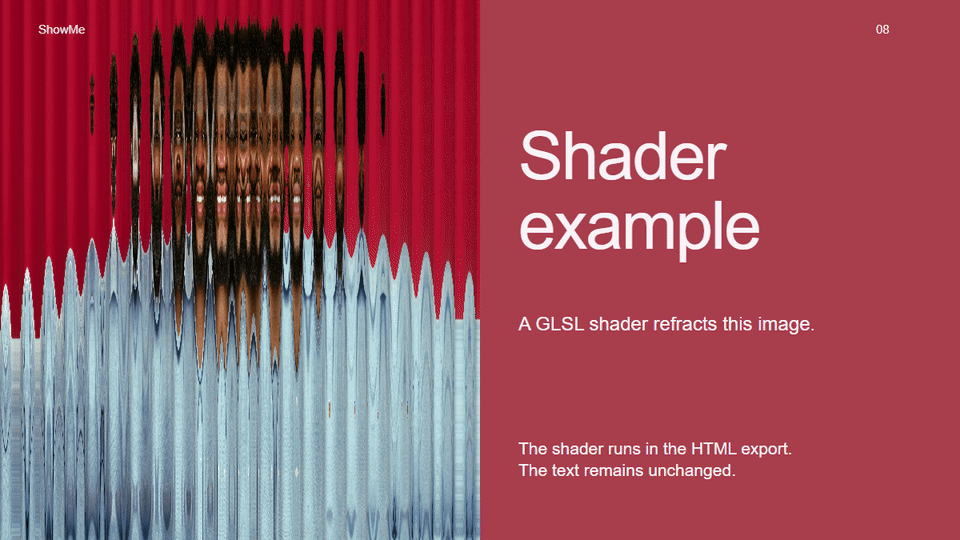

# ShowMe

ShowMe creates and presents slides. It runs locally on macOS and Windows, with
your presentations and assets on your own computer. No account or subscription.



## Why it exists

ShowMe uses a single asset library based on the filesystem. You can browse and
retrieve the media files directly. Presentations share images and videos instead of
keeping a separate copy of everything in every file.

It also isn't Keynote (it works on Windows), and it isn't PowerPoint (it works
at all).

## What it does

- Images, SVGs and video
- Media frames: Fit, Fill or Free positioning; video trimming, looping and sound
- Shared local asset library: folders, previews, duplicate detection, ordinary files
- Layers, groups, snapping, guides and rulers
- Slide templates and shared Text Styles
- Animation timeline: keyframes, easing, click-driven entrances and exits
- CSS on elements
- JavaScript text effects
- GLSL shaders: dynamic backgrounds, distortion and overlays
- Effect editor with live preview and reusable effects
- Presenter console: notes, next slide, timer and separate audience screen
- Portable `.smp` files with all used assets included
- PowerPoint import and export; PDF export
- Single-file HTML export, including assets and an offline player
- Local MCP for AI agents (experimental)
- LAN collaboration (experimental)

## See it in slides

- [ShowMe feature presentation, as standalone HTML](docs/showme.html): download
  the file and open it in a browser. Assets and the player are included.
- [Editable ShowMe deck](examples/showme.smp): the same presentation, with its
  assets packed into the file.



Twelve slides about ShowMe, with editor, asset library and Click Timeline
screenshots, click-driven animation, a JavaScript text effect and live shaders.
The shader example refracts a portrait, then clears the distortion over 0.7 seconds.




## Files, assets and sharing

Choose a ShowMe root folder for your work. The `ShowMe Library/` folder inside it
holds shared assets. Keep managed presentations below that root so library
cleanup can find which assets they use.

| Format | What it is for |
| --- | --- |
| `.sme` | A presentation that references assets in your local ShowMe Library. |
| `.smp` | A portable presentation with its used assets packed into the file. |
| `.html` | A standalone presentation and player you can open in a browser, offline. |
| `.pptx` | Moving slides to or from PowerPoint. |
| `.pdf` | Static pages. |

PowerPoint conversion has limits. ShowMe Motion, appearance timing and slide
transitions do not survive PowerPoint export, and custom browser effects do not
all translate. Check the result before handing it to someone.

Fonts need attention when moving files. Export settings let you leave fonts out,
turn text into SVG outlines, or include font files where your license permits it.
Outlines preserve appearance but turn exported text into graphics. Without
embedded fonts or outlines, another computer may substitute a font.

Local recovery keeps a record of edits after an interrupted session. Back up your
ShowMe root as you would any other folder of work.

## Install and run

This is a source release; there are currently no official installers. Use
Node.js 24 or 26.

```bash
git clone https://github.com/KonradJuenger/ShowMe.git
cd ShowMe
npm ci
npm run desktop
```

`npm run desktop` builds and launches the Electron app. `npm run dev` starts the
browser development version; `npm run build` builds without launching.

To make a downloadable app, run `npm run package` on the target platform, or use
**Actions → Build binaries → Run workflow** on GitHub. The workflow builds Mac
Intel and Apple Silicon DMG/ZIP files and Windows installer/portable EXEs.
Artifacts stay available for 30 days; the workflow does not publish a release.
Mac builds are ad-hoc signed, not notarized, and Windows builds are unsigned.
macOS may require **System Settings → Privacy & Security → Open Anyway** on first
launch.

## Experimental bits

### Collaboration

LAN collaboration synchronizes presentation edits. It does not transfer the
library files. Sync the complete ShowMe root separately, for example with
Syncthing, and select each computer's local copy. Absolute paths can differ.
Missing assets appear as placeholders until their files arrive.

Use a trusted local network: the collaboration connection is not encrypted.

### MCP

ShowMe has a local MCP server. In **Settings → MCP · Experimental**, enable it
and copy the configuration for your client. Node.js 24 or 26 is required.

Agents can inspect the open presentation, measure text and preview slides. Turn
on **Allow agent editing** to let them create slides, import assets, apply effects
and save or package through the editor. Agent edits have separate undo history.
Both switches are off by default. Guest editing in collaboration is not supported.

[MCP setup and supported operations](docs/mcp/LOCAL_SETUP.md) has the details.

## Development and license

See [CONTRIBUTING.md](CONTRIBUTING.md) for setup and contributions,
[tests/README.md](tests/README.md) for local checks, and
[docs/README.md](docs/README.md) for the rest of the documentation.
[SECURITY.md](SECURITY.md) covers security reporting;
[release readiness](docs/PUBLIC_RELEASE_READINESS.md) tracks outstanding work.

ShowMe is licensed under [AGPL-3.0-or-later](LICENSE). Third-party example photos
have their own terms, listed with the [example credits](examples/README.md).
