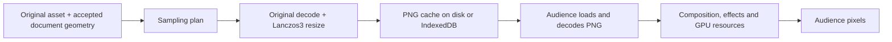

# Audience image pipeline: analysis before refactoring

Analysis date: 2026-10-13. Implementation inspected at
`741ec24f17774e8fb1a1b0846e031f1b33f68370` on
`chatgpt/audience-loading-reproduction`. This step changes documentation only.

The intended audience path is correct: resize from the original beforehand, load
the prepared pixels beforehand, then reveal them on navigation. The current cache
implements reusable resized PNG files, but does not guarantee either complete
preparation or readiness in the audience renderer. A cached PNG contains
compressed bytes; decoded pixels and GPU resources are later representations.



Today, stages C through F can still happen after a slide advance. The refactor
must move image generation off the navigation path and prepare the upcoming
audience composition before it becomes active.

**The current path, from editor to audience**

| Stage | What happens now | Owner / source |
| --- | --- | --- |
| Import | Preserve the original bytes under a content hash. Read intrinsic dimensions; optionally generate a small JPEG Library preview. | `electron/storage/media.ts`, `components/mediaEnrichment.ts` |
| Authoring | Store the asset identity, frame, Fit/Fill/Free settings, crop/zoom, parent transforms and motion in the current document. Accepted operations remain authoritative. | `core/media.ts`, `core/element.ts`, `DocumentRuntime` / `DocumentAuthority` |
| Sampling | Resolve templates and media geometry; include parent scale and maximum authored motion scale; plan the entire image rectangle, including cropped-away pixels. Ceil each target axis independently. Canvas requests use 256-pixel tiers; presentation requests use exact integer dimensions. | `core/presentationImages.ts` |
| Background preparation | Plan only the selected slide and immediate neighbours. Keep reusable descriptors for that demand window. Other slides are not scheduled to completion. | `core/imagePreparationCoordinator.ts` |
| Native cache lookup | Resolve/verify the original, read cached source metadata, clamp requested dimensions to source dimensions, derive an immutable key from recipe + asset hash + width + height, validate/reuse the PNG. | `electron/main.ts`, `electron/storage/imageVariantCache.ts` |
| Native cache miss | Read and verify original bytes; apply EXIF orientation; resize directly from the original with Sharp Lanczos3 and `fastShrinkOnLoad: false`; tag sRGB; encode PNG; validate and publish it. Two reusable workers share a memory admission limit. | `electron/imageProcessor.ts`, `imageProcessorPool.ts`, `core/imageWorkQueue.ts` |
| Browser cache | Use the same sampling planner and recipe identity. Store PNG blobs in IndexedDB; on a miss, decode the original in a worker, resize with Pica Lanczos3, encode PNG and publish under a lock. | `platform/browser.ts`, `browserImageCache.ts`, `imageWorker.ts` |
| Renderer request | Each image requests its own prepared descriptor. The endpoint resolves the slide and computes requirements again; it does not consume the coordinator's prepared descriptor directly. | `components/usePreparedImage.ts`, `electron/main.ts` |
| Audience decode | Decode a probe before adopting a new variant; load the visible `` and await its decode before clearing its loading marker. Matching hashes retain an existing decoded URL while the component remains mounted. Two decode waits do not necessarily mean Chromium performs two independent full decodes. | `components/usePreparedImage.ts`, `SlideRenderer.tsx` |
| Audience readiness | Wait for image loading markers and fonts; flush effect surfaces; send `audience-ready`. Native presentation additionally awaits `capturePage()` before releasing the shared presentation clock. | `usePreparedSlideImages.ts`, `AudienceOutput.tsx`, `electron/presentationRuntime.ts` |
| Final pixels | CSS transforms and clipping compose ordinary images. Effect paths may rasterize into canvases and upload textures; their texture filtering is linear. These stages are not all controlled by the Lanczos resize kernel. | `SlideRenderer.tsx`, `elementRaster.ts`, `effectRuntime.ts`, `effectSources.ts` |

Paths under `components`, `core` and `platform` are relative to `src/`.

The Library JPEG preview and cached slide thumbnail compositions are separate
derived views. They are not the audience-quality image cache. Normal audience
image rendering uses the prepared PNG, or the original when preparation is
unsupported/unavailable; it does not deliberately use the small Library JPEG.

**Measured failures**

The real 30-slide deck was opened from a copy with isolated app data and an
explicitly isolated empty image cache. Original assets were read from the existing
Library. The source presentation bytes were unchanged after the diagnostic.

- After preparation settled, status reported `ready`, with 6 of 6 requirements
  complete. The resolved whole-deck plan contained 52 requirements for 51 image
  assets. Only 6 of those exact whole-deck variants existed in the cache. There
  were 40 PNG cache entries overall: file count alone includes other view sizes
  and does not prove audience coverage.
- Background/presenter preparation used a display profile of `2561 × 1601`.
  The audience independently computed a fitted profile of approximately
  `2560.24994 × 1440.14059` from its viewport and DPR.
- On slide 25, one photograph was prepared as `1284 × 1711`, while the audience
  requested `1283 × 1711`. These are different cache keys. The mismatch request
  took about 1574 ms, including any queueing and processing; total audience
  readiness took about 1637 ms in this run, despite presenter preparation having
  finished before navigation.
- Mounting first used `scale = 1`, requesting yet another profile of approximately
  `3080 × 1732.5`. The fitted profile followed immediately. Cache job count rose
  by three across this navigation. Obsolete in-flight work can finish even after
  the renderer abandons its request.
- After source-size caps, the two profile calculations produced different image
  cache dimensions for 14 of 58 image instances, affecting 9 slides. This is not
  solely a slide-25 case.
- Earlier full-deck navigation measurements reached about 3.1 s on slide 25 and
  3.2 s on slide 27; warm revisits were about 130 ms and 230 ms. Delay depends on
  newly needed variants and resources, rather than increasing uniformly with
  slide number.

The sampling plan also explains why duplicate work hurts: slide 25's originals
are about 21.3 and 24.3 megapixels. Current admission estimates are roughly
488 and 557 MiB respectively, so those jobs cannot run together under the
512 MiB estimate budget. Generating an abandoned initial-size variant can occupy
the slot needed for the actual audience image. These are admission estimates,
not measured resident-memory usage.

**Where the current preparation contract breaks**

1. **Preparation is local to a demand window.** `ImagePreparationCoordinator`
   selects at most previous/current/next slides. It does not progressively finish
   the deck in the background. Its `ready` status means that window's PNG work
   completed, not that all audience images are ready.
2. **Output geometry has multiple independent calculations.** The coordinator and
   presenter use rounded display dimensions. The audience derives a fitted
   viewport profile. Initial mounting uses a provisional scale. Exact-size cache
   identities amplify even one-pixel disagreement into another original resize.
3. **Status reads change preparation demand.** The editor's
   `ImageReadinessStatus` polls every 750 ms with its selected slide. Native
   `imageReadiness()` prioritizes that slide in the same coordinator used by
   presentation. The editor can redirect preparation away from the audience.
4. **Preparation generations invalidate consumers too broadly.** Changing demand
   produces another document-wide generation. All mounted prepared-image hooks
   recheck, including unchanged images, and temporarily mark themselves checking.
   Retaining an identical URL avoids some repeated decode work, but not the
   requests or readiness churn.
5. **Audience lookahead stops before image pixels.** `AudienceOutput` mounts only
   previous/current slides. It scans future projections for video warmup, but
   does not retain the upcoming image composition. `SlideCache.warmPreviews`
   deliberately skips presentation images, expecting mounted views to decode
   them. The next-image warmup therefore has no consumer.
6. **Lower-value consumers can outrank the audience.** Native foreground editor
   canvas work has priority 2; audience and presenter exact-image requests share
   priority 1; coordinator/background and thumbnail work use priority 0. Editor
   canvas work can outrank audience work. Presenter console and editor presenter
   dock both load/decode current and next images in separate renderers.
7. **There is no application-owned guarantee of retained audience pixels.** A PNG
   cache hit avoids original resizing/encoding, but still requires loading and
   PNG decoding in the audience process. Current readiness does not establish
   permanent decoded or GPU residency for a future slide.

The native cache is session-scoped by default. `deleteImageCacheOnClose` defaults
to true; retained reuse across app launches is enabled when that setting is false.
This policy is separate from preparation within the current presentation.

Browser persistence uses the same document and planning contracts, but its
execution details differ: queues are local to each page, workers are created per
cache miss, and foreground priority is not passed to the image queue. First
descriptor calculation can decode the original just to determine dimensions.
These need to be considered when keeping browser and native behavior aligned.

**What pixel-perfect Lanczos output means here**

The existing native and browser resizers explicitly use Lanczos3 for reduction.
Native processing reads the original for every new variant, avoiding cascaded
resizing from another derivative. The browser worker disables unsharp masking.
These quality choices should be retained.

However, a Lanczos PNG is not proof of Lanczos sampling at every final screen
pixel. Integer target dimensions, fractional placement, rotation, animated scale,
source-size caps, CSS transforms and effect composition can add later sampling.
The planner uses a maximum-motion envelope, so the cached raster can be larger
than the image at a particular animation time. Current prepared images do not
upscale past source dimensions; enlargement stays with the renderer.

The refactor should define a static audience reference: original source,
orientation, physical output geometry, crop and subpixel placement, alpha and
colour handling. Check fine detail and representative final captured pixels
against that reference. Motion and effect output need their own sampling contract;
preserve their current semantics rather than flattening slides into screenshots.
The current colour path is SDR sRGB, with native high-bit-depth PNG preservation
where supported and browser canvas precision limits; whole-pipeline HDR or
bit-identical cross-runtime output has not been established.

The [Sharp resize documentation](https://sharp.pixelplumbing.com/api-resize/)
describes Lanczos reduction and the separate interpolators used for enlargement.
The [Pica documentation](https://github.com/nodeca/pica) describes its Lanczos3
filter and canvas precision limits. The
[HTML image decode contract](https://html.spec.whatwg.org/multipage/embedded-content.html#dom-img-decode)
provides decode completion and short-term availability, rather than indefinite
decoded-image residency.

**Requirements for the refactor**

1. Compute one canonical audience output profile from the actual output surface.
   Use that same profile and resolved accepted document geometry for background
   planning, cache identity, presenter reuse and audience consumption. Never start
   image work from a provisional mount scale.
2. Build the whole visible deck's audience image plan. Prioritize the active and
   upcoming slides, then progressively finish all encoded variants. Before
   claiming complete presentation preparation, require every supported planned
   variant to be available. Replan affected images after accepted edits or output
   changes without changing the document architecture.
3. Distinguish encoded-cache completion, audience decode completion and composition
   readiness. Prepare and retain the upcoming audience composition within a
   bounded memory budget. Ordinary forward navigation should reveal prepared
   output without original reads, resizing, PNG generation or new image decode.
   Arbitrary jumps also need explicit preparation; bounded memory cannot guarantee
   all distant slides remain decoded indefinitely.
4. Give audience preparation first claim on processing and memory during
   presentation. Presenter and editor reuse completed results and accept softer
   or delayed previews. Pure status queries must not redirect demand. Cancel or
   demote obsolete queued work before it blocks audience requests.
5. Consume stable prepared descriptors/identities instead of asking every image
   to replan its slide. Keep readiness changes separate from content or explicit
   cache invalidation. A neighbouring slide entering/leaving the demand window
   must not invalidate unchanged audience pixels.
6. Preserve the original-source Lanczos quality path and validate the final
   audience result. Measure time separately for cache lookup, queueing, original
   processing, PNG read/decode, composition and presentation handoff. Monitor
   memory across audience, console and editor processes.

The existing whole-deck plan for the measured display totals approximately
284 MiB of decoded RGBA for its unique required variants, before extra copies,
GPU textures and effect surfaces. This supports separate policies for broad disk
coverage and bounded audience memory. It is not a universal allocation target.

The refactor stays inside the existing
`Editor -> EditorSession -> DocumentTransaction -> DocumentAuthority` ownership
and durable recovery path. All new image plans and ready pixels are disposable
derived resources. Keep the current formats, original asset identities,
Fit/Fill/Free behavior, motion, effects, presentation clock and collaboration
semantics intact.

**Verification for this analysis**

The isolated native diagnostic verified coverage, profile mismatch, request sizes,
new-job counts and audience readiness on the real deck. Results remain outside
the repository in a temporary diagnostic directory; no private deck or assets
are committed.

Focused commands on this implementation:

```powershell
$env:SHOWME_TEST_FILES='["tests/feature/media/image-sampling.test.ts","tests/feature/media/retained-images.test.ts"]'
npx vitest run

$env:SHOWME_TEST_FILES='["tests/feature/presenter/audience-navigation.spec.ts"]'
npx playwright test --config playwright.config.ts
```

Sampling and retained-image contracts: 15 passed. Audience navigation regression:
1 failed as expected, reporting two new cold variants on entry to slide 25.
The earlier temporary next-slide mounting countercheck made that synthetic test
pass; the countercheck was reverted. It does not prove that mounting alone fixes
the real profile mismatch, scheduling, whole-deck coverage or pixel fidelity.

No production files changed in this step. Full/release suites, a new build,
typecheck and lint were not rerun for this documentation change. The required
audience gate remains red, so integration into `main` remains blocked.
