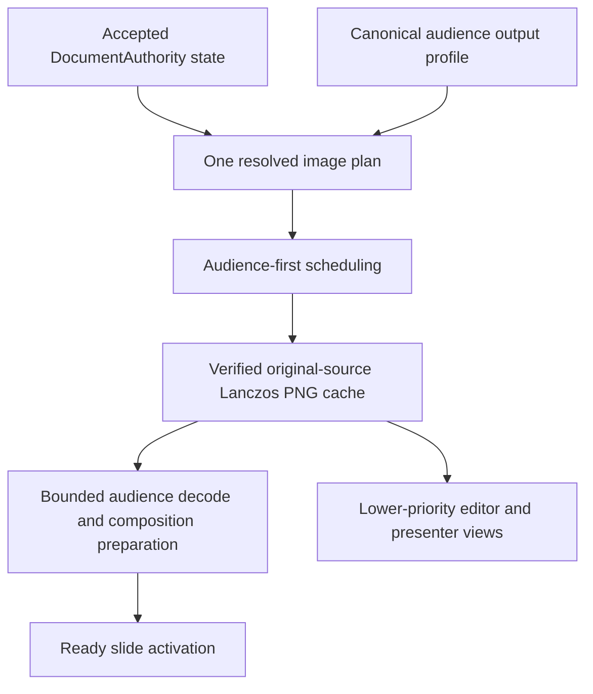

# Audience-first image pipeline refactor plan

2026-10-13. Planned from implementation
`7d42f5c9b25cc033c76ffd9867edf35d66bbc0bc` and the
[pipeline analysis](audience-image-pipeline-analysis.md).
This document plans the complete refactor; it does not implement it.

The goal is that preparing a presentation does the expensive image work once,
at the audience's required sampling quality. Advancing to a prepared slide
activates retained output. Editor and presenter views consume available results
at lower priority.

**Required result**

- One audience output profile determines every audience image request, cache key
  and renderer sampling decision. Initial mount and ordinary navigation produce
  no alternate provisional sizes.
- Before a presentation is declared fully prepared, every supported static
  image requirement in its visible slide sequence has a verified encoded result.
  Preparation runs during editing whenever the target output profile is known.
- Current, incoming and outgoing audience resources are retained within an
  explicit memory budget. Ordinary forward navigation to a ready neighbour
  starts no original image reads, resizing, PNG encoding or image decode work.
- Readiness reports distinguish whole-deck encoded preparation from readiness
  of the actual audience composition. A status read never changes demand.
- Audience work outranks editor, console, dock and thumbnail work.
- Original-source Lanczos3 reduction, geometry, crop, colour and alpha handling
  are preserved and checked at final audience output. Motion, video, effects and
  authored transition timing remain live.
- The existing audience-navigation regression passes unchanged in intent and
  remains the required gate for every integration into `main`.

The fast-navigation contract applies to the admitted ready window with unchanged
content and output geometry. A distant jump, display change, accepted image edit,
explicit cache clear or resource loss requires preparation before reveal. Those
events must not cause an unprepared image to flash or consume its entrance clock.

**Architecture and ownership**



Refactor `ImagePreparationCoordinator` into the owner of derived document image
plans, encoded preparation status and priority. Keep `ImageVariantCache` and the
browser cache as platform implementations of the same derived-resource contract.
Keep audience resident resources in the audience renderer, where decoding,
composition, video players and effect resources actually live. These are distinct
stages of one pipeline, not alternate document owners.

All plans derive from the current accepted document and resolved templates. Keep
`Editor -> EditorSession -> DocumentOperation[] -> DocumentTransaction ->
DocumentAuthority -> durable recovery -> accepted revision` intact. No alternate
deck representation, persistent editor runtime or slide screenshot renderer.

**Concrete design decisions**

| Concern | Decision |
| --- | --- |
| Audience output profile | A disposable profile records actual viewport dimensions, DPR, fitted slide scale and physical sampling extent. Compute the fit and rounding in one pure function. Publish one immutable profile identity to the coordinator and all consumers. |
| Profile negotiation | Prepare from validated selected-output geometry before presentation where possible. The audience reports settled actual geometry at startup/fullscreen/resize. Confirm the prepared profile, or replace it and complete preparation before reveal. An estimate cannot certify final readiness. |
| Image identity | Preserve recipe + verified source identity + normalized final dimensions. Clamp against oriented source dimensions before deduplication. Revision and navigation position do not become pixel cache keys. Change the recipe only if processing actually changes. |
| Plan identity | Track document epoch, accepted revision, output identity and per-slide requirement signatures. Advance metadata on unrelated accepted changes without invalidating unchanged image identities. |
| Consumer mapping | The plan maps slide/element identities to stable prepared descriptors. Resolve template inheritance and maximum-motion sampling once per affected slide/profile, not once for each rendered image. |
| Encoded coverage | Plan the entire current presentation sequence, deduplicate requirements, and progressively finish it. Current/next work runs first; all remaining requirements remain scheduled instead of falling out of a three-slide window. |
| Decode ownership | Retain actual canonical audience media views and their stable sources, rather than warming disposable probes. Reference-count shared image identities within that renderer; release URLs/resources only when all retained owners leave. |
| Resident window | Retain current, previous/outgoing and next slide as the minimum normal-navigation set; add the following slide when the byte budget allows. Pin the outgoing composition until its transition ends. |
| Memory | Keep the existing conservative 512 MiB processing admission policy initially. Separately budget resident decoded images and effect surfaces; start with a 256 MiB preparation target, shared-image accounting and measured native/browser overhead. These limits are implementation policies calibrated by the real-deck run. |
| Oversized slides | Evict optional distant lookahead first. Allow one required oversized composition to make progress, suppress competing preview work, and report estimated/observed costs. Never silently reduce audience sampling to fit a budget. |
| Scheduling | During presentation: required audience work, upcoming audience work, remaining deck encoding, presenter reuse, editor work, thumbnails. Editor gestures retain their existing displayed pixels when new preview generation is deferred. |
| Cancellation | Remove obsolete queued demand; merge duplicate demand by normalized identity and strongest role. A valid running job may finish into the immutable cache, but cannot publish stale readiness or replace current pixels. Do not terminate useful shared jobs merely because one consumer left. |
| Cache retention | Preserve existing cache-location, clear and retention preferences. Whole-deck preparation does not require a `.sme`, `.smp` or asset-format change. |
| Browser coordination | Keep one image-work scheduling owner for the local document/session, backed by the existing browser document owner and messaging. Other pages request results from it. Use existing cache locks for cross-session publication; avoid independent per-view processing queues. |
| Transport trust | Derive consumer priority from the authenticated native window or browser session role. Validate document scope, profile ownership and plan identity; a preview cannot claim audience priority or request another document's resources. |
| Composition | Continue using `SlideRenderer`. Preallocate/warm image inputs and effect surfaces without running future slide clocks, autoplay or stateful effects early. Clock-dependent draws remain live. |

The 256 MiB resident target excludes the permitted active/outgoing oversized case;
it is not a hard promise about browser or OS GPU residency. Detect failures and
resource loss and re-establish readiness before reveal. Measure actual usage so
decoded copies, retained DOM compositions and effect textures do not get counted
as free resources.

**Lifecycle and product behavior**

| Trigger | Required behavior |
| --- | --- |
| Open/edit | Resolve the audience plan for a known output profile. Prepare visible-deck variants progressively; prioritize useful slides without dropping the rest of the plan. |
| Present | Establish/confirm actual output geometry, finish encoded coverage, and prepare initial audience output plus its next neighbour. Use the existing preparation UI to report progress; release the presentation clock only when initial output is ready. |
| Normal next/previous | Reuse retained compositions and image identities. Navigation changes activation and clocks, not cache generation. Replenish lookahead after activation. |
| Fast repeated navigation | Preserve ordered command/step semantics. Cancel obsolete preparation and validate readiness against the latest active target; stale completions cannot acknowledge another slide. |
| Distant jump | Promote the target and prepare its composition from completed encoded variants. Keep the previous output until the target is ready, then perform the existing jump semantics. Do not consume future motion time while waiting. |
| Accepted live edit | Replan affected slides/template users. Reuse unchanged normalized identities, refresh changed encoded variants and affected compositions, and guard activation against stale revision/signature. Renderer-local gesture previews never drive the accepted audience plan. |
| Display/fullscreen/DPR change | Negotiate a new profile identity, reuse exact compatible variants, prepare new requirements and rebuild affected resident sampling. An old-profile completion cannot certify the new output. |
| Cache clear/settings change | Separate explicit cache invalidation from ordinary progress. Keep already displayed pixels stable where possible; cancel obsolete work, rebuild the selected pipeline, and honor caching-disabled original rendering with the existing quality boundary. |
| External Library change | Use existing verified-source notifications to invalidate affected descriptors and compositions. Preserve original hash checks and interrupted/corrupt cache recovery; cached descriptors cannot override a detected source mismatch. |
| Missing/unsupported/corrupt asset | Distinguish supported prepared images, deliberate original-render paths and definitive missing assets. Readiness must settle or report actionable failure; a processing failure cannot be disguised as successful pixel preparation. Keep established missing-asset behavior. |
| End/restart/close | Preserve restart-media semantics without discarding unrelated prepared images. Release derived resources when their owners close; honor cache retention and safe cleanup. |
| Collaboration | Use the same accepted authority state and existing asset verification. Each local audience profile remains local derived state; host/guest edits invalidate the same affected requirements. |

Complete encoded coverage at Present is the chosen default. Startup may wait if
the profile has only just become known or the deck is still preparing. Move this
work earlier during authoring rather than hiding it in later navigation. Status
labels must describe that state accurately. Missing assets and supported original
render paths are separate outcomes, not an excuse to count failures as cached PNGs.

Retaining previous output while a cold target prepares is an intentional audience
behavior improvement for this refactor. Navigation order, shortcut meaning,
motion steps, transitions, pause and timer semantics otherwise stay established.

**Implementation sequence and reviewable commits**

| Step | Focus and affected files | Exit criterion |
| --- | --- | --- |
| 1 | Canonical geometry and stable identities: `core/presentationImages.ts`, `core/renderProfile.ts`, `platform/api.ts`, `electron/presentationRuntime.ts`, `AudienceOutput.tsx`, `usePresenterController.ts`. | Fractional-DPR/display-fit tests show one normalized image identity for planner, audience and preview reuse. No work starts at provisional scale 1. |
| 2 | Stable plan consumption: refactor `core/imagePreparationCoordinator.ts`; add narrow bulk plan/result transport in native/browser platform; simplify `usePreparedImage.ts` and `SlideRenderer.tsx`. | Per-image consumption uses planned descriptors. Unchanged images survive navigation, status updates and unrelated revisions without new requests/decodes. |
| 3 | Whole-deck scheduling: `core/imageWorkQueue.ts`, `electron/storage/imageVariantCache.ts`, `imageProcessorPool.ts`, `platform/browser.ts`, `browserImageCache.ts`, `imageWorker.ts`, `ImageReadinessStatus.tsx`. | All supported visible requirements complete; status queries are read-only; audience overtakes preview queues; deduplication, cancellation, worker recovery and immutable publication pass. |
| 4 | Audience residence and readiness: `AudienceOutput.tsx`, `usePreparedSlideImages.ts`, `audienceImagePreparation.ts`, `slideCache.ts`, existing effect/video resource ownership. | Existing navigation blocker becomes green. Upcoming pixels prepare during dwell; activation starts no cold work or decode calls. Outgoing content remains valid through transitions. |
| 5 | Lifecycle integration: presentation startup/commands, profile changes, accepted-impact invalidation, browser owner messaging, IPC role checks. | Startup, rapid navigation, jumps, live edits, display changes, close/restart and explicit clears obey readiness identities and established clocks. |
| 6 | Lower-priority consumers and cleanup: editor canvas prefetch, rail/native previews, `PresenterConsole.tsx`, editor presenter dock, image-generation subscriptions. | Audience-owned preparation cannot be redirected by the editor. Preview demand reuses cached descriptors or remains deferred. Obsolete generation/polling/passthrough paths are removed. |
| 7 | Quality and runtime validation: sampling/renderer fixtures, effects output, native handoff instrumentation and real-deck diagnostics. | Final audience pixels meet the quality reference; native and browser runs show no generation on prepared navigation, stable bounded resources and the latency target below. |

Implement native and browser contracts together within each applicable step. Do
not leave an old pipeline behind a temporary compatibility switch. Add tests with
the step that establishes their contract. Steps 1–3 can remain working history on
the task branch while the audience-navigation blocker is red. No such intermediate
state may enter `main`.

No new public persisted format is planned. Keep new profile/plan/readiness metadata
in local runtime transports, outside persisted document/presentation records. If
implementation requires changing a currently supported persisted or public wire
format, version it and update its writer, reader, fixture and immediately supported
migration together, as required by `AGENTS.md`.

**Pixel fidelity work**

Keep the current original-source Lanczos3 reduction, EXIF handling, lossless PNG,
sRGB output, native precision preservation and deliberate unsupported-format
paths. Preserve the maximum-motion envelope so entering an animation does not
resize an image mid-playback. Never generate an audience variant by resizing an
editor thumbnail or another reduced variant.

Make physical sampling and placement part of the quality reference. Test the
actual final output for integer-aligned static images, fractional placement,
Fit/Fill/Free crops, nested scales, rotation, anisotropic scale, alpha, orientation
and representative colour. Static aligned images with exact dimensions should
match the reference pixels; declare and justify any tolerance only where the
existing compositor/colour transform genuinely requires it.

Retain the canonical renderer for CSS, effects, text and video. A cached maximum-
size image still undergoes composition during motion/rotation; this plan does not
claim every dynamic transform is a fresh Lanczos resize. Profile the final sampling
and fix visible fidelity defects inside the existing renderer. Introducing a second
renderer, flattening interactive slides or snapping authored geometry to hide a
quality mismatch would violate the retained product contracts.

Keep the native `capturePage()` readiness fence initially. Measure its warm cost
after cold image work is removed. Narrow or replace it only with equivalent native
first-frame evidence and passing clock/transition tests; do not remove it merely
to improve a timer. The same principle applies to current probe/visible decode
waits: replace their ownership with retained ready views, preserving failures and
fallback behavior.

**Verification and completion criteria**

Prefer deterministic contract checks over wall-clock sleeps. Extend the existing
30-slide regression without weakening its assertions. Add fractional-profile and
resident-decode checks, early/late unique-asset entry, prepared reverse navigation,
rapid commands and unchanged-identity retention. Controlled preparation and decode
gates should prove what happens before versus after activation.

Domain tests cover normalized identities, full sequence planning, template
dependencies, deduplication, priority/cancellation, invalidation, failure outcomes
and memory admission. Browser component tests cover retained image ownership,
composition readiness and clocks. One focused native synthetic test must exercise
the actual IPC/profile/cache/worker/renderer boundary; mocks alone would miss the
real one-pixel mismatch. Retain native and browser original-source pixel-quality
checks and add final-output reference cases where this refactor changes sampling.

Register every new/revised test appropriately, update `lastReviewed`, and regenerate
committed stats. The audience-navigation group remains active and mandatory.

For real-deck verification, use isolated data/cache and a document copy. Test cold
open, fully prepared forward traversal, reverse traversal, warm repeats, new
audience window, distant jumps and output changes. Include the reported late
slides, a 4K output, fractional DPR and 20–24 MP synthetic photographs. Keep private
decks/assets outside the repository.

Record original reads, resize/PNG jobs, per-stage queue/processing/read/decode
costs, ready-to-reveal latency, long tasks, decoded-image bytes, effect/GPU estimates
and process memory. Once encoded preparation and the resident window are ready,
normal sequential navigation must show zero cold image jobs and zero application
image-decode requests on activation. Confirm with runtime traces that browser
decoder/raster work is not simply hidden by an application counter.

The performance target is p95 command-to-first-correct-audience-frame under 100 ms
for already prepared normal image slides on the measured development machine,
excluding an authored transition's duration. Report 2560-pixel and 4K results,
machine/display details, baseline and outliers; this is an acceptance benchmark,
not a flaky CI time threshold. Late slides should not acquire a second-scale
generation cost. Dynamic effects, unsupported images and cold distant jumps are
reported separately with their required behavior, rather than mixed into that
number.

Per-step verification uses the smallest relevant feature group plus core/static
checks after production changes. At completion, run the affected feature areas,
then full verification once because the change crosses shared planning, native,
browser and rendering boundaries:

```text
npm run test:feature -- media
npm run test:feature -- presenter
npm run test:feature -- motion
npm run test:feature -- effects
npm run test:feature -- editor
npm run test:feature -- persistence
npm test
npm run typecheck
npm run lint
npm run test:stats
npm run test:audit
npm run test:full
npm run build
npm run verify:build
```

Install Chromium before browser checks. Run the relevant native Electron paths
and Windows/macOS display scenarios; report any unavailable platform instead of
claiming coverage. Packaging/release verification requires separate release scope.

The refactor is complete only when the critical test passes, complete encoded
coverage is honest, audience request identities agree, retained navigation starts
no cold work, final pixels pass the quality contract, memory remains controlled,
and existing editing/presentation/persistence behavior passes verification.

Keep implementation and working commits on
`chatgpt/audience-loading-reproduction`. Push reviewable work there. After the
developer explicitly authorizes integration, verify the exact candidate against
the latest `main` on an isolated branch/worktree, including the mandatory audience
gate, before modifying `main`. Follow the existing squash, test, push and cleanup
rules. Planning this refactor is not authorization to integrate it.
