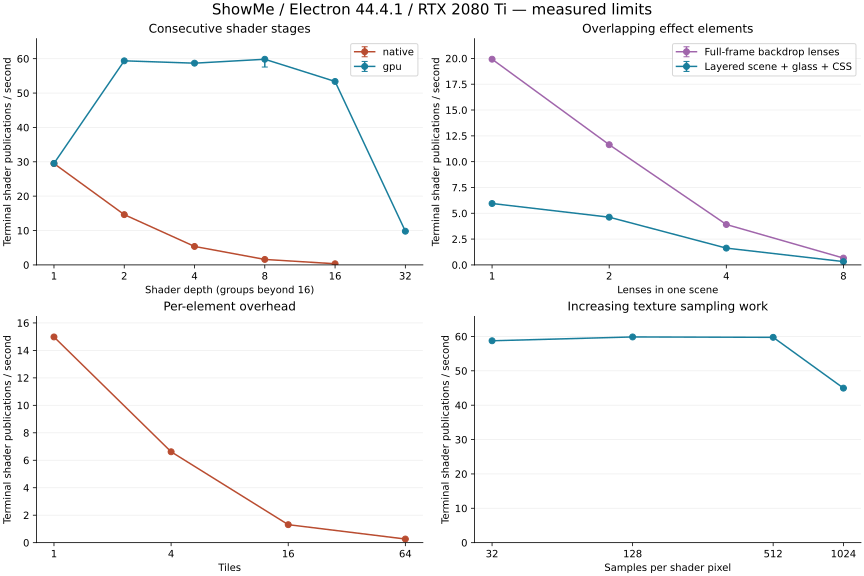
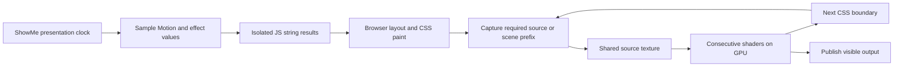

# Mixed CSS, JS, media and shader effects: Electron benchmark

This experiment measures the current capture approach and a small GPU handoff prototype on the supplied `css_js_shader.sme`. The purpose is to find the practical limits of layered scenes and use that evidence to design the next rendering/animation interaction. It is an experimental branch, `experiment/mixed-effect-compositing`.

Renderer implementation commit: `cb8032a6703c5bd865e49f5e04c7387df74760b5`. The recorded matrix used that implementation before the narrow empty-string invalidation fix described below. The benchmark tools, compact results and this report are in the following commit on the same branch.

## What was built

The renderer evaluates JS text in its existing isolated workers, applies CSS and content shaders in their authored order, and captures browser-painted inputs using Chromium HTML-in-Canvas. Capture includes computed styles, text layout, shadows, clipping, pseudo-elements, images, video frames and previous shader canvases. Captures retain mirrors and reuse unchanged snapshots. Dependencies paint before their consumers; continuously changing inputs coalesce rather than preventing publication forever.

The experimental GPU variant gives consecutive content shaders an RGBA8 framebuffer texture directly. CSS decoration, clipping, transforms and pseudo-elements between those stages force browser capture. GPU handoff is **disabled by default**; the benchmark enables it in memory. The prototype still copies every shader output to a DOM canvas and retains captures allocated during initialization/fallback, so its memory use remains high.

The Electron startup flag enables the experimental native capture API. The SVG serialization backend exists only as a benchmark control. There is no browser product fallback. See the [Chromium API description](https://developer.chrome.com/blog/html-in-canvas-origin-trial) for the platform mechanism; the actual runtime versions below come from Electron itself.

The document authority, semantic operation path, persisted v1 formats, assets and recovery paths are retained. Fixtures are renderer-local derivatives validated against the current schema. The original document and library are read-only; each native run uses copied assets in a private profile/library. JS still has no DOM, network or Electron bridge. Text functions transform strings before pixel effects; the current v1 contract permits one enabled text function per text element and at most 16 effects per element. Deep stacks use nested groups, without changing those limits.

## Machine and method

Windows, Intel i9-9900K (16 logical CPUs), 31.93 GiB RAM, NVIDIA RTX 2080 Ti via ANGLE/D3D11. Electron 44.4.1, Chromium 152.0.7977.78, 125% display scaling. Hardware canvas, rasterization, WebGL and video decode are enabled. The private window's content viewport is 1920 × 1080 CSS pixels; output profiles are 1280 × 720, 1920 × 1080 and 3840 × 2160.

The source SHA-256 is `2867d55e2739782c0f496365779f72c3268e2d35bd8914bb4430b642b29501fd`. The real source image is 4798 × 3200 and the video is 2048 × 1080. Native asset readiness is checked before measuring. Each generated case uses the source media and text, alongside generated shader/CSS/JS definitions.

The discovery sweep measures three seconds after 800 ms warm-up. Important native/GPU comparisons are repeated three times with five-second measurement windows. These are short, single-machine measurements; repeat ranges describe these trials, not a hardware-independent capacity guarantee. Cases run serially, in fixed order. Setup has a 30-second wall limit; settle has an eight-second limit. A timed-out private process tree is terminated before the next case. Earlier probes with smaller windows, incomplete memory accounting or different scene layouts are excluded from the final data.

The benchmark mounts the real `SlideRenderer` through the real Electron preload and native asset broker, using a controlled renderer clock. It excludes the editor's inspectors, document writes, collaboration and presenter transitions from timing. PNG inspection and pixel reads happen outside the measured interval. Dedicated 1.5-second traces run separately, so tracing does not contaminate the tabulated measurements.

Measurements distinguish:

- **rAF rate:** renderer scheduling opportunities. A scene can report 60 rAF/s while its final shader changes only a few times per second.
- **Terminal output rate:** publications from outermost shader surfaces. The minimum across independent terminal elements is reported; a shader producing zero events contributes zero. This measures published shader frames, including uniform-only updates, rather than unique video/source frames. CSS/JS-only scenes have no terminal shader, so that column is blank.
- **Capture and upload rate:** totals across all inputs. Multiple stages can capture the same scene. These totals are not the freshness of a particular source.
- **Input delay:** delivery time of a zero-delay timer queued each animation frame, a renderer responsiveness proxy rather than a measured hardware mouse-to-display latency.
- **Canvas allocation:** logical RGBA8 bytes for all live DOM canvas bitmaps, including nested mirror copies. It excludes GL input textures, drawing buffers, driver copies, decoded media and managed image caches. GPU output textures are counted separately. Neither figure is measured VRAM residency.
- **Process memory:** Electron private bytes sampled before/after the interval. It is neither peak memory nor GPU VRAM.
- **Trace times:** inclusive, attributed to their recorded thread. Nested events and work on different threads overlap; adding them would invent an exclusive CPU total. GL draw timing in the runtime measures command submission, not GPU completion.

## Workloads

The matrix varies shader depth, CSS/shader alternation, independent element count, overlapping backdrop lenses, JS worker fan-out, video count, output resolution, shader sampling work and capture backend.

The composite family explicitly constructs this scene:

```text
generated shader background
  + source image in a smaller frame (background remains visible)
  + playing source video
  + JS animated text with CSS
  + overlapping Glass Ripple elements sampling the lower scene
  + CSS on each lens
  → enclosing CSS + content shader
  → another enclosing CSS + content shader
```

There are also 2/4/8 independent copies of that scene; 1/2/4/8/16 full-frame backdrop lenses; 1/4/16/64 tiles with a constant total pixel area; up to 512 text workers; up to 16 videos; and shader runs with 32/128/512/1024 texture samples per pixel. Some workloads deliberately exceed comfortable use. Setup timeouts are recorded as unsuccessful cases, not assigned a fabricated FPS.

## Results

Final numerical tables and plots accompany this report in `results.json`, `results.csv` and `limits.svg`. Raw per-case samples, screenshots and Chrome traces remain in `test-results-effects-stress`.

The final sweep contains **76 scenarios: 71 completed without diagnostics/missing assets/document mutation, and five exceeded the 30-second setup limit**. The six repeated comparisons all completed in all three trials (18 additional measurements).

### Consecutive shaders versus CSS boundaries

| Workload                         | Backend               | Median output/s | Observed range (3 × 5 s) |
| -------------------------------- | --------------------- | --------------- | ------------------------ |
| 4 consecutive shaders            | Native capture        | 5.37            | 5.18–5.38                |
| 8 consecutive shaders            | Native capture        | 1.59            | 1.58–1.59                |
| 8 alternating CSS/shader effects | Native capture        | 3.59            | 3.58–3.59                |
| 4 consecutive shaders            | GPU handoff prototype | 58.69           | 58.67–59.04              |
| 8 consecutive shaders            | GPU handoff prototype | 59.83           | 57.57–59.85              |
| 8 alternating CSS/shader effects | GPU handoff prototype | 3.58            | 3.58–3.59                |

Four consecutive shaders improve about 11×, and eight about 38×. Alternating CSS/shader boundaries show no corresponding improvement. The GPU output rate includes new uniforms over an older captured source; source capture remains about 30/s in these media cases. It is not a claim of 60 distinct video frames/s.

### Layered scene and element fan-out

| Scenes × lenses/scene | rAF/s | Minimum final output/s | Input delay p95 (ms) | Canvas MiB |
| --------------------- | ----- | ---------------------- | -------------------- | ---------- |
| 1 × 1                 | 31.38 | 5.95                   | 45.50                | 119.36     |
| 1 × 2                 | 25.08 | 4.62                   | 72.10                | 164.29     |
| 1 × 4                 | 20.16 | 1.63                   | 94.00                | 271.28     |
| 1 × 8                 | 16.96 | 0.32                   | 222.90               | 553.84     |
| 2 × 2                 | 17.17 | 0.97                   | 110.10               | 415.77     |
| 4 × 2                 | 12.40 | 0.00                   | 172.90               | 1180.33    |

Eight copies of the two-lens scene exceed setup limits. Four copies finish, but at least one terminal output emits no frames in the three-second interval. Zero is a measured result, not a missing metric.

| Tiles, fixed total area | rAF/s | Minimum output/s | Canvas MiB |
| ----------------------- | ----- | ---------------- | ---------- |
| 1                       | 59.91 | 14.98            | 39.55      |
| 4                       | 27.13 | 6.62             | 39.55      |
| 16                      | 8.83  | 1.31             | 39.55      |
| 64                      | 2.63  | 0.26             | 39.55      |

The 64-tile case has roughly the same 39.55 MiB canvas allocation as the single tile, but falls to 2.63 rAF/s and 0.26 final updates/s. Per-element scheduling, style/layout and capture overhead matters independently of pixel area.

### Sources, resolution and shader work

| Independent JS text elements | rAF/s | Returned strings/s per element |
| ---------------------------- | ----- | ------------------------------ |
| 128                          | 59.48 | 59.15                          |
| 256                          | 37.32 | 36.99                          |
| 512                          | 17.54 | 17.22                          |

Sixteen CSS effects retain 60.22 rAF/s in this workload. These controls show that CSS or isolated string transformation alone is substantially cheaper than repeated mixed pixel capture.

| Videos behind one lens | Final output/s | Decoded frames | Dropped frames |
| ---------------------- | -------------- | -------------- | -------------- |
| 0                      | 29.91          | 0              | 0              |
| 1                      | 19.95          | 90             | 0              |
| 2                      | 9.94           | 182            | 0              |
| 4                      | 9.89           | 364            | 0              |
| 8                      | 9.89           | 730            | 3              |
| 16                     | 6.52           | 1705           | 8              |

At sixteen videos, eight drops occur among 1,705 decoded frames while final composition runs at 6.52 updates/s. Decoder drops are a small part of this slowdown. Counts are aggregate across videos over the actual measured interval.

| Case                                     | Output/s | Canvas MiB |
| ---------------------------------------- | -------- | ---------- |
| 1920 px composite                        | 4.62     | 164.29     |
| 1280 px composite                        | 4.27     | 91.77      |
| 3840 px composite                        | 2.61     | 555.90     |
| 32 texture samples/pixel, 4 GPU stages   | 58.75    | 119.18     |
| 128 texture samples/pixel, 4 GPU stages  | 59.86    | 119.18     |
| 512 texture samples/pixel, 4 GPU stages  | 59.75    | 119.18     |
| 1024 texture samples/pixel, 4 GPU stages | 44.96    | 119.18     |
| 4K, 8 GPU stages, 32 samples/pixel       | 58.95    | 1434.38    |

This particular high-locality 1,024-sample kernel reaches about 45 outputs/s. Cheap and 32-sample native stacks perform nearly alike because capture dominates first. The GPU kernel results are not a capacity estimate for arbitrary shader programs.

### Memory and failed cases

| Consecutive shader depth | Backend | Canvas MiB | Additional output texture MiB | Output/s |
| ------------------------ | ------- | ---------- | ----------------------------- | -------- |
| 4                        | native  | 144.49     | 0.00                          | 5.30     |
| 8                        | native  | 415.55     | 0.00                          | 1.66     |
| 16                       | native  | 1337.34    | 0.00                          | 0.33     |
| 4                        | gpu     | 119.18     | 31.64                         | 59.30    |
| 8                        | gpu     | 390.23     | 63.28                         | 58.62    |
| 16                       | gpu     | 1312.03    | 126.56                        | 53.37    |
| 32                       | gpu     | 4674.38    | 253.13                        | 9.80     |

The GPU prototype preserves fallback mirrors from startup. Faster publication does not make those allocations disappear. Its 32-stage case retains about **4.56 GiB of canvas bitmaps**, plus 253 MiB of output textures, and falls to 9.80 outputs/s. Direct texture handoff therefore needs memory/lifecycle work before becoming the default.

| Case                                  | Outcome                                     |
| ------------------------------------- | ------------------------------------------- |
| mixed-d64-n1-v1-p1920-light-native    | Setup exceeded 30 s; private app terminated |
| backdrop-d1-n16-v1-p1920-light-native | Setup exceeded 30 s; private app terminated |
| mixed-d8-n1-v1-p1920-light-svg        | Setup exceeded 30 s; private app terminated |
| composite-d2-n8-v1-p1920-light-native | Setup exceeded 30 s; private app terminated |
| shader-d64-n1-v1-p1920-light-gpu      | Setup exceeded 30 s; private app terminated |

The cached native mixed-eight case is 3.62 outputs/s; rebuilding native mirrors every capture gives 2.32 outputs/s. SVG serialization never completes setup for the same live-media workload. That is an unsuccessful baseline, not a zero-FPS steady-state comparison.

### Trace evidence

| Thread                 | Inclusive event                           | Total ms in separate trace | Calls | Max ms |
| ---------------------- | ----------------------------------------- | -------------------------- | ----- | ------ |
| CrRendererMain         | v8.callFunction                           | 1153.63                    | 4336  | 29.55  |
| CrRendererMain         | Paint                                     | 679.91                     | 218   | 18.73  |
| CrRendererMain         | RasterImplementation::ReadbackImagePixels | 330.39                     | 86    | 4.74   |
| CrGpuMain              | GPUTask                                   | 260.49                     | 574   | 2.85   |
| DedicatedWorker thread | v8.callFunction                           | 4.50                       | 59    | 1.91   |

These events overlap. They establish significant paint/readback/synchronization work; they must not be summed into an exclusive CPU cost.



[Compact JSON](results.json) · [All measurements as CSV](results.csv)

Screenshots: [layered scene with two glass lenses](../../../test-results-effects-stress/composite-d2-n1-v1-p1920-light-native-trial1.png), [aligned red rectangle at 57% zoom](../../../test-results-effects-alignment/zoom-0.57-slide-1-shader.png). Screenshots/traces are ignored local artifacts; compact data and plots are committed.

## What limits the current path

1. **Serial browser paint boundaries.** Native capture waits for paint. If its input contains a canvas/video bitmap, it waits for a preliminary paint to commit that bitmap before recording. Each shader-to-browser-to-shader hop adds paint latency. The single-stage media case approaches 30 capture updates/s on this 60 Hz run; subsequent serial boundaries reduce final publication rate.
2. **Repeated layout/style work.** Each capture freezes the source subtree, reads computed styles and pseudo-elements, updates media copies and compares a fingerprint. Retained mirrors eliminate rebuilds of unchanged trees, but active video and text still cause work. Many small elements remain expensive at the same total pixel area.
3. **Hidden upstream copies.** A captured shader stage still contains its hidden source subtree. Mirrors copy those nested canvases too. For a simple depth-N stack, the number of retained upstream shader bitmaps grows approximately as N². This explains the large memory increase as shader depth rises. The first video is also copied at intrinsic dimensions, even when the output is smaller.
4. **Readback and synchronization.** Traces show browser paint, `ReadbackImagePixels`, and GPU/GL synchronization alongside JS/style work. Native capture uploads fresh RGBA inputs; every shader then copies its GL output back into a 2D DOM canvas. These transfers remain in the GPU prototype's DOM publication path.
5. **Real GPU cost after capture is reduced.** Raising texture samples per pixel and using 4K output can finally tax shader arithmetic/memory bandwidth. The heavy cases separate that limit from the largely similar cheap and 32-sample native results.
6. **Independent source costs.** Worker fan-out and video fan-out add startup, scheduling, layout and decoder costs. Decoder frame drops must be interpreted separately from final composition FPS. A video can decode successfully while its lens updates slowly.

## Position and fidelity verification

The reported red rectangle displacement was caused by applying sampling scale twice during native recording. Native `drawElementImage` already maps the CSS capture viewport into the destination bitmap. The recording now uses an identity canvas transform, with world-to-lens coordinates on a descendant viewport. A second Chromium behavior required wrapping copied canvases/video bitmaps: the experimental painter records nested canvas pixels at intrinsic dimensions, so their CSS fitting is applied explicitly.

Screenshot comparison covers all three supplied slides at 35%, 57%, 100% and 200% zoom. For this comparison, media is removed, lens outlines are removed, and shaders become identity filters; CSS and JS remain. This isolates the red rectangle/text position. Real media appears in the native stress screenshots and asset checks. At 200% the standalone window clips the far right/bottom; that comparison covers the visible region only.

Red rectangle and text bounds agree within one physical pixel in all 12 comparisons. There is still a quality difference at reduced zoom: slide 2's weighted text ink changes by about −16.5% at 35% and −10.2% at 57%. Geometry passes; these comparisons do **not** claim pixel-identical antialiasing. Repeated rasterization and subpixel placement remain a fidelity problem for v2.

Deterministic renderer checks additionally cover 125% DPR, zoom, CSS changes to the lens width, live DOM identities, paused cache reuse, JS style keyframes, custom stylesheet keyframes, pseudo-element isolation, shader channel transformations with alpha, CSS boundaries, GPU context recreation and teardown.

Final review also fixed stale glyphs when a JS effect returns an empty string: removal of the live text node now removes its retained mirror node. Empty/restore transitions are covered by the mixed renderer check. The generated stress text never becomes empty; the recorded matrix predates this narrow invalidation fix.

## V2: rendering/animation interaction

The results favor a frame-scoped render graph with shared source pixels and GPU shader runs. It can remain entirely renderer-local, with the current document authority and persistent model.



The next implementation should:

1. Sample the current Motion/effect clock once per frame. Give renderer work a frame token containing accepted document revision, slide, sampled time and output profile. Workers/captures completing later must not overwrite a newer frame. Interactive rendering may coalesce older work; paused preview/export awaits the requested frame.
2. Compile dependencies for content groups and scene prefixes. Schedule lower scene elements before their lenses and descendants before parent consumers. Share a captured prefix across compatible lenses; keep ordering-specific prefixes distinct. Do not await every surface on every rAF.
3. Treat consecutive shaders as one GPU run, including safe group boundaries. Keep intermediate textures in framebuffer targets, reuse allocations, and publish only the visible result. Release fallback mirrors while a GPU run is active, and recreate them lazily when CSS/bypass requires capture. The current measured prototype proves a direct handoff within an element; it does not yet eliminate intermediate DOM copies or bridge arbitrary groups.
4. Keep CSS painting at the boundaries where it is required. Prefer stable native paint trees and shared snapshots; prune hidden shader inputs with explicit bypass/invalidation handling. Context-dependent CSS such as backdrop filters and blend modes needs the correct surrounding scene, not merely a detached content subtree.
5. Invalidate by actual inputs: document changes, Motion transforms, CSS animation samples, changed JS strings, loaded fonts/assets and decoded video frames. A shader's time uniform can change while reusing its source texture. Static/absent/offscreen sources should not keep polling the entire slide. Fresh video frames should use decoded-frame callbacks rather than duplicate per-source polling and full-size CPU canvas copies.
6. Bound temporary surfaces, worker concurrency and in-flight work. Account for textures, mirror bitmaps, captures and media together. Pool/release transient targets and apply explicit render-scale reduction when the budget is exceeded, preserving logical coordinates. The existing GL dimension caps alone do not constrain total memory. Preserve the current worker watchdog/isolation when introducing batching or a bounded pool.
7. Add telemetry for per-source frame age, dependency wait, exclusive CPU phases, upload/readback bytes, GPU timer results where available, allocation failures and reclaimed memory. Final publication FPS alone can hide old source pixels.

Useful next acceptance criteria are: the composite scenes retain media/text geometry and ordering; paused/export frames are deterministic; consecutive shader runs avoid stage-by-stage capture/upload; repeated scene prefixes are shared; stress degradation stays responsive and within an explicit resource budget; and reduced-zoom text fidelity improves. Exact supported CSS/context cases need product contracts before claiming universal combinations.

An Electron-specific follow-up is worth measuring if native CSS boundaries still prevent the desired cadence: offscreen rendering with `useSharedTexture`, rather than its default CPU bitmap output. Electron documents the GPU texture mode and an experimental `sharedTexture` bridge that imports platform texture handles, transfers them between processes, and exposes `VideoFrame`. The installed Electron 44.4.1 types contain these APIs. Their ownership/release rules must be respected, and the receiver must preserve ShowMe's existing security boundary. [Electron offscreen rendering](https://www.electronjs.org/docs/latest/tutorial/offscreen-rendering), [sharedTexture API](https://www.electronjs.org/docs/latest/api/shared-texture).

This is an **unmeasured alternative**, not a zero-copy performance claim for ShowMe. A future test should feed the same renderer-local CSS/media scene through that path, import the received frame into the shader pipeline, and measure transfers, latency, memory and fidelity before adding native integration. It must remain a rendering sink of the current document/clock, with no second editor authority or persistent model.

## Reproduce

Install dependencies and Playwright Chromium, build the Electron app, and run Vite on port 5173. Keep source files stable during measurements; hot module replacement can give explicit runtime imports and the harness different module instances.

```powershell
npm run build
npm run dev -- --port 5173 --strictPort
# In another PowerShell terminal:
node scripts/stress-effects.mjs "D:\01_Projekte\06_presentations\showme-examples\css_js_shader.sme" all 3000 1
node scripts/stress-effects.mjs "D:\01_Projekte\06_presentations\showme-examples\css_js_shader.sme" compare 5000 3
node scripts/verify-effect-alignment.mjs "D:\01_Projekte\06_presentations\showme-examples\css_js_shader.sme"
node scripts/summarize-effects-benchmark.mjs test-results-effects-stress/report-all-3000ms-1x.json test-results-effects-stress/report-compare-5000ms-3x.json
python scripts/plot-effects-benchmark.py
```

The stress runner accepts a family, `gpu`, `compare`, an exact case ID, or comma-separated selectors. Plot generation requires matplotlib. Inspect `.trace.json` files in Chrome's performance tooling or Perfetto. The benchmark uses the configured native asset library to copy only referenced assets and available fonts into its private library.

## Verification and remaining boundaries

- `npm run test:feature -- effects`: **76 unit + 33 Chromium harness checks passed**. Chromium is used for deterministic renderer checks, not as a browser product support target.
- `npm test`: **15 core checks passed**.
- `npm run test:feature -- motion`: **34 unit + 12 renderer checks passed**.
- `npm run test:feature -- media`: **30 unit + 8 renderer + 1 Electron check passed**, including a production build. The native preview check was also run directly: `SHOWME_TEST_FILES='["tests/feature/media/preview-electron.spec.ts"]' npx playwright test --config playwright.electron.config.ts`: **1 passed**.
- `npm run test:feature -- presenter`: **15 unit + 8 renderer + 1 Electron check passed**, including a production build.
- `npm run typecheck`, `npm run lint`: **passed** on the final source tree.
- `npm run build`: **passed**, including the final text-removal fix.
- `npm run test:stats`, `npm run test:audit`: **passed**; 350 active tests across 68 groups, with the added contracts registered at the effects feature tier.
- `node scripts/verify-effect-alignment.mjs SOURCE`: **all 12 position comparisons passed**; the measured antialiasing differences above remain.
- `node scripts/stress-effects.mjs SOURCE all 3000 1`: **76 scenarios recorded, 71 successful and five bounded setup timeouts**.
- `node scripts/stress-effects.mjs SOURCE compare 5000 3`: **18/18 repeated runs successful**.
- `node scripts/summarize-effects-benchmark.mjs ...`, `python scripts/plot-effects-benchmark.py`: **94 measurements summarized; JSON, CSV, SVG and PNG generated and inspected**.
- `git diff --check`: **passed**.

Browser harness runs used `SHOWME_TEST_PORT=5174` to keep module instances fresh. Some older harnesses log an application bootstrap error after replacing the root DOM; their maintained assertions pass. The new mixed-effects harness uses a dedicated entry page and does not have that race. That unrelated harness behavior was not modified.

Full/release/packaged verification, macOS, mixed-effect PDF/package export and multi-hour soak testing were not run. Native capture is an experimental Electron feature and this branch is not release-ready. The faster GPU path is a measured prototype, not the completed v2 scheduler. No original file, asset, document schema or authority path was changed.

All stress processes were stopped. Automatic approval review rejected recursive cleanup of the two abandoned probe directories `showme-effects-stress-GjH2IN` and `showme-effects-stress-mVJibD` under the user's temporary directory, with “blocked by policy,” including a narrower attempt using verified literal paths. Those copied temporary files remain; normal completed runs removed their private profiles/libraries.
