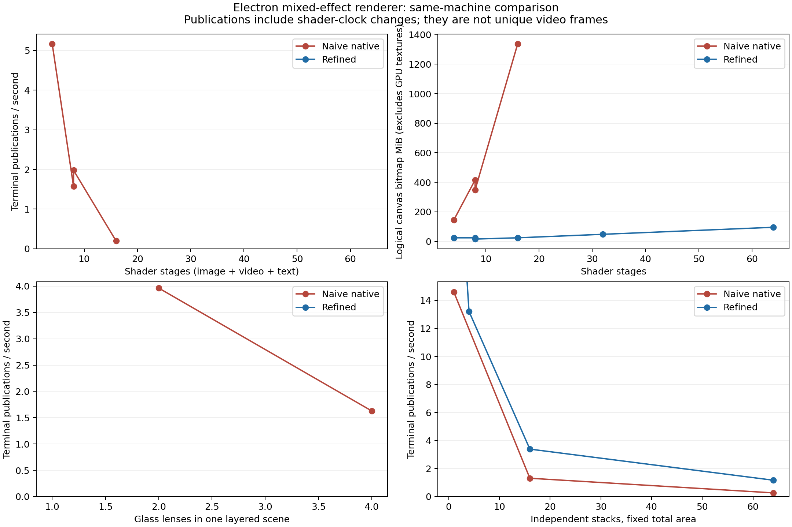

# Refined mixed-effect renderer: implementation and comparison

The refined renderer substantially reduces repeated captures and hidden canvas allocations. Eight consecutive shaders improved from a median 1.58 to 58.15 terminal publications per second. Alternating CSS/shader stages improved from 3.38 to 17.49. Heavy layered scenes remain slow, and the refined path has a reproducible video-drop regression with 16 simultaneous videos. **This is draft work, not ready to merge into main.**

See [HANDOFF.md](HANDOFF.md) for review priorities and proposed next experiments, and the [implementation plan](../mixed-effects-2026-10-12/IMPLEMENTATION-PLAN.md) for structure and scope. The [earlier benchmark](../mixed-effects-2026-10-12/REPORT.md) documents the naive approach and first GPU prototype.

## Implementation and boundaries

Implementation commits: `6843bad6989963b2d782faddaec0e48f8d1a75ed` and `53f60c78b2dc503081a9ff83cd78833f7e01e392`. The refined strategy is the default on `experiment/mixed-effect-compositing`. The retained naive strategy and old GPU experiment are explicit, renderer-local benchmark controls.

- `effectGraph.ts` coordinates content, CSS-wrapper and ordered-backdrop dependencies, shares in-flight work, preserves invalidations arriving during execution and rejects cycles. Independent stacks do not require a global rendering barrier.
- `effectSources.ts` creates sources on demand and owns reference-counted capture/upload leases. Identical backdrop inputs for the same target and sampling context can share ownership. Different lens targets or ordered prefixes are not merged.
- `effectRuntime.ts` keeps compatible consecutive shaders in framebuffer textures. It materializes DOM canvases at visible outputs or browser-paint boundaries, releases fallback sources when a GPU route becomes available, and retains fallback behavior on errors/bypass/context loss.
- `domRaster.ts` prunes hidden source subtrees behind completed shader outputs, observes scoped stylesheet changes and uses decoded-video callbacks in the refined path. Computed-style/pseudo-element capture and native painting remain browser work.
- Shader clock signatures avoid some unnecessary shader work. CSS/JS clock delivery remains conservative: arbitrary JS property access and inherited CSS custom variables are public API. Unchanged CSS values are not rewritten.

Interactive consumers may animate a completed shader texture while its next native snapshot paints. Explicit scene flushes share one dependency cohort and await requested inputs. This is not yet a complete immutable frame-token/source-freshness protocol.

DocumentAuthority, the current document architecture, v1 formats, persistence and isolated text workers remain in place. No original `.sme` or library asset was edited. Renderer-local fixture derivatives use the current document schema and existing effect limits.

## Approaches tested

1. **Naive native capture:** enables CSS, JS text, custom rules and media as shader inputs, but each boundary mirrors a large subtree and copies pixels. Hidden nested inputs produce growing memory and work.
2. **Retained mirrors and snapshot caching:** avoid some rebuilds and unchanged captures; computed-style reads and per-boundary capture still dominate mixed stacks.
3. **Initial GPU handoff prototype:** direct textures between consecutive shaders improve throughput, but eager mirrors and intermediate DOM copies retain excessive memory.
4. **Refined dependency/source/output ownership:** lazy captures, pruned mirrors, shared requests and optional DOM materialization remove substantial redundant work. Real CSS boundaries remain native captures.
5. **Shared scene-flush cohort:** the first refined limits sweep exposed repeated dependency resolution during readiness. The follow-up commit shares the cohort across the entire flush; all four previously timed-out cases subsequently initialized within the same 30-second setup limit.

Offscreen/shared-texture capture, full GPU-run compilation, scene-wide budgets, texture pools and general shared-prefix composition are proposals, not implemented or benchmarked alternatives.

## Method and evidence

Windows; i9-9900K; RTX 2080 Ti through ANGLE/D3D11; 31.93 GiB RAM; Electron 44.4.1 / Chromium 152; 1920 × 1080 content viewport and 125% Windows display scaling. Source: `css_js_shader.sme`, SHA-256 `2867d55e2739782c0f496365779f72c3268e2d35bd8914bb4430b642b29501fd`. Its image is 4798 × 3200 and video 2048 × 1080.

[results.json](results.json) and [results.csv](results.csv) contain **82 measurements across 45 scenarios**: 78 completed and four initial setup timeouts. The timeouts remain in the data; their targeted five-second reruns after the cohort fix succeeded. Every completed record retained an unchanged fixture and settled without effect diagnostics. Rows record implementation SHA and input report. Group summaries select the longest measurement duration; the discovery sweep and cohort follow-up are explicitly different implementation phases.

Cases ran serially in the real Electron renderer/native asset broker, after an 800 ms warm-up. Discovery windows were three seconds; important pairs were three five-second trials. Setup limit: 30 seconds; settle limit: eight seconds. Separate 1.5-second traces and screenshots were outside measurement windows. No tests or renderer edits ran during timed trials. Fixed ordering, short windows and one machine limit generalization.

The renderer mounts generated fixtures through `SlideRenderer`; it excludes editor panels, persistence, collaboration and presenter transitions from timing. The layered scenes are in-memory derivatives, not separate saved presentation files.

**Publication fps measures terminal output revisions, including shader-clock changes. It does not measure unique video frames or end-to-end source age.** rAF measures the main-thread frame loop; timer latency is an input-latency proxy, not a real keyboard/drag measurement. Capture/worker wait times are cumulative and overlap across sources. Trace event durations are inclusive and are not GPU execution timings.

Logical canvas MiB includes materialized canvases and retained mirrors. Refined input and framebuffer textures are counted separately. These are allocation estimates, not measured VRAM, resident RAM or peak memory. Driver copies, shared drawing buffers, decoded media and caches are excluded. Naive input textures are not instrumented; their reported input-texture zero must not be read as zero allocation. Style-read counters describe the capture source; sampling and GPU-bridge layout checks still read computed styles outside those counters. Draw submission timing is not whole-frame CPU cost or GPU execution time.

## Repeated results

| Fixture | Naive median fps (range) | Refined median fps (range) | Naive / refined canvas MiB |
| --- | ---: | ---: | ---: |
| 4 consecutive shaders | 5.16 (3.38–5.38) | 59.05 (54.79–59.27) | 144.49 / 24.26 |
| 8 consecutive shaders | 1.58 (1.39–1.58) | 58.15 (57.72–59.47) | 415.55 / 24.26 |
| 16 consecutive shaders | 0.20 (0.197–0.198) | 58.94 (58.35–59.21) | 1337.34 / 24.26 |
| 8 alternating CSS/shader stages | 3.38 (2.79–3.39) | 17.49 (17.30–21.13) | 144.49 / 95.45 |
| Layered scene, 2 glass lenses | 3.96 (1.98–3.98) | 9.34 (8.94–9.76) | 164.29 / 136.51 |

The eight-shader refined case additionally owns 63.28 MiB of framebuffer textures and 7.91 MiB of uploaded source texture. Comparing its 24.26 MiB of canvas alone with the naive canvas count does not establish a 17× reduction in total memory.

## How realistic is the layered scene?

It deliberately stresses a plausible combination: animated procedural shader background, source image and video, JS-animated text, the supplied glass shader, and CSS after the lenses. However, each glass lens spans **85% of slide width and height**, or about 72% of its area, and the lenses overlap. Two enclosing full-slide groups each add another CSS/shader pair. The background shader uses twelve trigonometric iterations per pixel.

This is an aggressive scene, not an unchanged source slide or representative slide with two small glass panels. The stress fixture contains ten effect instances. A realistic small-panel benchmark and a refined run of the original three source slides remain follow-up work; the source-slide screenshot checks below test alignment, not their live performance.

## Actual limits and regressions

- **Static pixels:** eight shaders without video reached 60.04 fps after warm-up, with zero new captures, computed-style reads in the capture source or uploads. Shader sampling/bridge checks still run. Only the visible terminal was copied to DOM; 301 copies served 2408 shader draws. This directly demonstrates the requested “do little work when pixels are unchanged” behavior.
- **DOM-only controls:** CSS depth 16 and JS count 128 remain near 60 rAF fps, with zero pixel captures and owned input/output textures. At 512 isolated JS effects, rAF fell to 18.00 naive / 16.37 refined. This implementation does not solve worker/message/DOM-update scaling.
- **Deep GPU stacks:** 32 shaders produced 27.31 fps, with 47.99 canvas + 253.13 output + 15.82 input MiB. At 64, two five-second runs produced 9.19–9.31 fps, with 95.45 canvas + 506.25 output + 31.64 input MiB. Video drops were 129/153 and 131/155 at 64 stages. Successful rendering is not acceptable interaction/video quality at this load.
- **Alternating boundaries:** 32 CSS/shader stages produced 4.49 terminal fps and 8.98 rAF fps. Sixteen shader inputs/captures still need substantial browser work; GPU handoff cannot erase genuine CSS boundaries.
- **Many stacks:** 64 fixed-area CSS/shader tiles produced 1.17 fps versus 0.27 naive. Their total canvas bitmap area stayed 39.55 MiB. Per-stack overhead remains important even when total area is fixed.
- **Layered scenes:** two overlapping lenses improved effect throughput, but refined rAF ranged 18.28–19.51 versus naive 12.69–23.78. The four-scene follow-up produced 1.68 terminal fps, 3.73 rAF fps and a 1140 ms timer-latency p95. Its logical canvas/input/output total was about 891 MiB. Some discovery comparisons also showed lower refined rAF despite higher publication rates.
- **16 videos — confirmed merge blocker:** composition throughput stayed roughly six fps. Three additional matched trials recorded naive video-drop fractions of **0.34%, 1.04%, 0.39%**, versus refined **48.52%, 47.29%, 46.46%**. The decoded-callback path is a candidate to isolate, not a proven sole cause. A polling-versus-decoded-callback experiment has not been run. Do not describe the video path as an improvement or hide these drops behind publication fps.
- **4K heavy shader chain:** the discovery case improved from 0.99 to 59.70 publications/s, but the refined textures alone consume 253.13 MiB of output storage, besides inputs, canvases and decoded assets.

The separate 64-stage trace recorded about 1.37 seconds of inclusive `FireAnimationFrame` time and main-thread calls up to roughly 141 ms in a 1.5-second trace. It also recorded native readbacks and command waits. This points toward main-thread scheduling/validation and capture overhead as well as allocation pressure; it is not a measurement of GPU saturation. More function-level attribution is needed before assigning exact costs to graph invalidation, layout checks or uniform setup.

## Screenshot correctness

All three supplied slides were compared with identity shader versus original at zoom 0.35, 0.57, 1 and 2 in Electron/DPR 1.25. Red element and text bounds stayed within one screenshot pixel. At zoom 2 the right/bottom of the slide are viewport-clipped. Media and strokes are removed only in this geometry fixture.

[alignment.json](alignment.json) preserves the measurements. The original red-element position regression is fixed. Pixel fidelity is not universally exact: slide 2 text coverage still changes by −16.46% at zoom 0.35 and about −10.2% at 0.57, with essentially unchanged bounds. Fractional text rasterization remains a merge requirement.

## Verification and merge requirements

- `npm run test:feature -- effects`: **82 unit + 33 browser passed** on the final renderer.
- `npm run test:feature -- motion`: **34 unit + 12 browser passed** after fixing absent-owner dirty retention.
- `npm run test:feature -- media`: **30 unit + 8 browser + 1 Electron passed**.
- `npm run test:feature -- presenter`: **15 unit + 8 browser + 1 Electron passed**.
- `npm test`: **15 passed**; `npm run typecheck`, `npm run lint`, `npm run build`: **passed** after the final renderer change.
- `npm run test:stats`, `npm run test:audit`: **356 active declarations / 69 groups**, valid registry. The six execution-graph/source-ownership tests are registered in effects.
- `node scripts/stress-effects.mjs SOURCE v2limits 3000 1`, `... v2cold 5000 1`, `... v2compare 5000 3`, `... v2extras 5000 1`, and the explicit native/refined 16-video IDs with `5000 3`: **82 recorded measurements**.
- `node scripts/verify-effect-alignment.mjs SOURCE`: **12 source-slide comparisons completed**; `node scripts/summarize-effects-benchmark.mjs --destination=docs/benchmarks/mixed-effects-2026-10-13 ...` and `python scripts/plot-refined-effects-benchmark.py`: **artifacts generated**.

One earlier overlapping browser run had an artifact-directory teardown failure; serial reruns passed. Some existing harnesses still log a bootstrap error when replacing the application root, as documented in the baseline report. Two repeated benchmark-launch failures were resolved by avoiding unchanged HTML rewrites and waiting directly for the harness root; they are not throughput measurements.

Before main: fix video drops; implement frame/work and memory budgets; validate source-age/frame coherence and stale completions; measure realistic small glass panels and unchanged source slides; expand alpha/blend/filter/clip/transform correctness at GPU boundaries; resolve fractional text fidelity; validate mixed-effect export/presenter profiles and macOS; run extended/full/release/packaged verification and a long soak. Scene-wide budgets, GPU-run pooling and general prefix composition are currently absent.

Full, extended, release/packaged, macOS, mixed-effect PDF/package export and multi-hour soak checks were **not run**. Browser support is not a target. The original source hash remains unchanged. Completed benchmark processes were stopped and their private copies cleaned; older abandoned probe directories remain documented in the baseline report.
