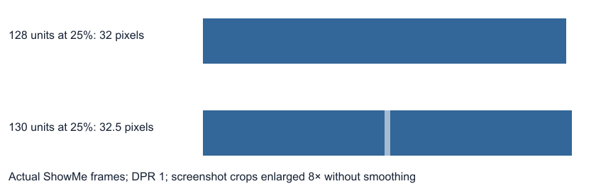
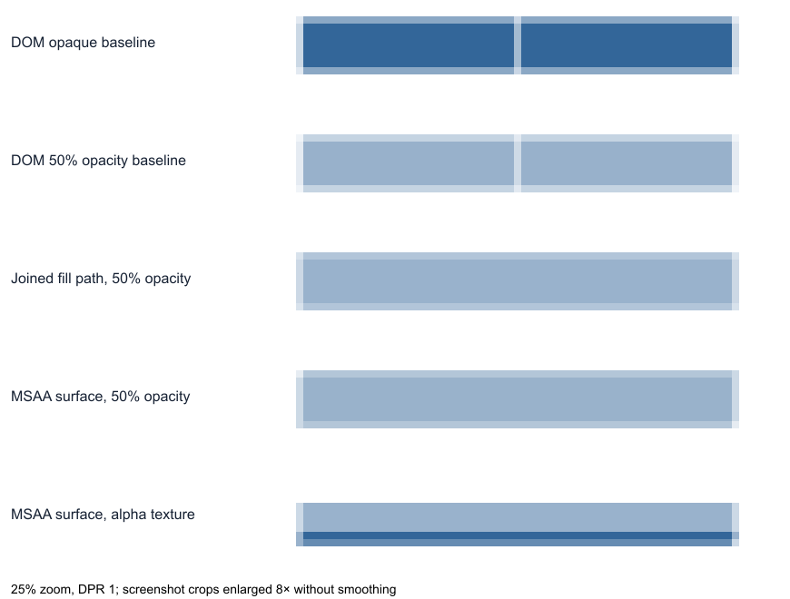

# Adjacent frame seams: investigation in progress

Recorded 2026-10-13 against `7640df7c2b4d229a4baa51567b095d9d1901946b`.
This branch documents the investigation and includes the limited canvas-fringe
color fix described below. It does not implement an adjacent-frame seam fix.

## Problem and current conclusion

The developer reports a thin line between adjoining frames with the same fill
color, and sometimes a small yellow line around the canvas.

The frame seam reproduces with zero geometric gap, zero stroke, zero corner
radius, and no effects. Its visibility depends on zoom, position, display density,
and clipping. Integer slide coordinates do not ensure integer device-pixel edges.

A filled, unrotated rectangle painted directly on device-pixel boundaries should
be sharp. In the latest production-renderer experiment, **all 168 cases with
complete device-edge alignment had exactly uniform pixels across the join**.
We have not reproduced blurred edges in that fully aligned control.

This is not a complete diagnosis of every reported seam. Some minimal transformed
fixtures show a seam even when the measured shared edge is an integer device
coordinate but other bounds are fractional. The exact Chromium paint/compositor
stage responsible for those cases has not been traced. A DOM bounding rectangle
does not expose intermediate raster surfaces.

No specific rendering change has been accepted. The next work is to identify
where alignment or edge coverage changes in the existing renderer.

The subsequent [render-only pixel-snapping experiment](pixel-snap-results.md)
quantifies a successful device-coordinate painting prototype, failed local-CSS
rounding variants, displacement, thin-element collapse, and synthetic DOM costs.
It is not enabled in production and does not use dynamic region combining.

## Constraints and rejected directions

The developer has explicitly ruled out dynamic region combining/batching as a
solution. Do not continue implementing it from these prototype results.

Other approaches discussed are unsuitable or unproven:

- Overlapping frames changes geometry and darkens translucent content. Four
  slide units is too much; even one unit does not reliably remove the seam.
- Adding a backing fill or replacing objects with one large frame is not an
  acceptable layout workaround.
- Rounding document coordinates to a pixel grid is considered messy. A render
  alignment experiment is not authorization to change stored geometry.
- A new multisampled renderer raised substantial cost and scope concerns. Its
  visual prototype was not benchmarked and is not a proposed implementation.

Any future fix must preserve fractional geometry and transparency, existing
selection/media/text behavior, paint order, and the current document architecture.
No parallel document model, authority, or persistence path is involved here.

## Current rendering path

Relevant code at the investigated revision:

- [`Editor.tsx`](../../../src/components/Editor.tsx): effective canvas scale is
  `fitScale * zoom`. The canvas is positioned using centering, pan, and
  `translate(-50%, -50%)`. The footer rounds the displayed scale percentage.
- [`EditorCanvas.tsx`](../../../src/components/EditorCanvas.tsx): the stage uses
  CSS `scale(canvasScale)` with a top-left transform origin.
- [`SlideRenderer.tsx`](../../../src/components/SlideRenderer.tsx): every element
  has its own positioned outer div, frame transform, and opacity. The fill is a
  separate inset div inside a visual wrapper. `clipChildren` makes that wrapper
  use `overflow: hidden`.
- [`element.ts`](../../../src/core/element.ts): neutral frame transforms still
  produce `scale(1, 1) rotate(0deg)`.

For unrotated elements without further ancestor transforms, the approximate
mapping is:

```text
device edge = (canvas CSS origin + slide edge * canvas scale) * devicePixelRatio
```

Integer slide coordinates, integer CSS coordinates, and integer physical-pixel
coordinates are different conditions. Browser layout precision, clipping,
compositor raster scale, and intermediate surfaces may further affect painting.

## Latest experiment: device alignment

The retained [manual reproduction](reproduce.mjs) mounts the actual
`SlideRenderer` using current document factories. It creates synthetic documents
in an isolated browser context; it does not open or change the developer's files.
It measures DOM bounds and screenshot pixels without modifying the renderer.

The 448-case matrix covers:

- Clipped empty frames and ordinary rectangle shapes.
- Widths 128 and 130, height 32; stroke/radius zero; fill `#336699`.
- Object opacity 1 and 0.5.
- Zoom 25%, 50%, 75%, 100%, 125%, 150%, and 200%.
- Device pixel ratios 1, 1.25, 1.5, and 2.
- A fixed origin and a half-device-pixel-shift control.

All five measured bounds (left, shared edge, right, top, bottom) are considered
aligned only within 0.0001 device pixels of integers. The shared edge is compared
with an interior sample of the same fill. Exact differences and differences above
two RGB levels are reported separately; the latter is a measurement convention,
not an acceptable product tolerance.

| Observation                                        | Result |
| -------------------------------------------------- | -----: |
| Cases                                              |    448 |
| Completely device-aligned cases                    |    168 |
| Exact seam differences in aligned cases            |      0 |
| Fractional cases with a channel difference above 2 |    112 |
| Browser page errors                                |      0 |

A concrete pair at DPR 1, zoom 25%, and canvas origin x=16:

```text
width 128: shared edge = 16 + 128 * 0.25 = 48   -> uniform
width 130: shared edge = 16 + 130 * 0.25 = 48.5 -> seam
```

Both have exact document adjacency and integer document geometry. At the
fractional join, the clipped frame's seam sample was `[164, 187, 209]` and the
ordinary shape's was `[101, 140, 179]`, versus interior `[51, 102, 153]`. Clipping
amplified the artifact in this example; this does not establish its exact internal
implementation. Not every fractional case produces a seam.



## Earlier experiments and their limits

### Layout workarounds

The initial current-renderer matrix ran 432 cases per variant with widths
120/120.3, four fractional origins, nine zooms from 25–200%, and DPR 1/1.25/2.

| Variant                        | Cases with channel difference above 2 | Maximum difference |
| ------------------------------ | ------------------------------------: | -----------------: |
| Exact adjacency                |                                   290 |                113 |
| 1-unit overlap                 |                                    64 |                 65 |
| 4-unit overlap                 |                                     0 |                  1 |
| Continuous opaque backing fill |                                     0 |                  2 |
| Single continuous fill         |                                     0 |                  0 |
| 4-unit overlap at 50% opacity  |                                   432 |                 51 |

The initial advice that a one-unit overlap usually hides the seam was too broad.
These workarounds are not the direction to pursue.

### Native CSS changes

Settled, freshly remounted current-renderer fixtures tested several paint and
compositing changes. Each opaque variant had 432 cases. None solved the matrix:

| Variant                                                      | Cases with channel difference above 2 |
| ------------------------------------------------------------ | ------------------------------------: |
| Baseline                                                     |                                   290 |
| `will-change: transform` on slide host                       |                                   120 |
| `will-change: transform` on individual elements              |                                    54 |
| `isolation: isolate` on slide host                           |                                   290 |
| CSS `zoom` instead of host transform scaling                 |                                   114 |
| Neutral transform removed and fill moved onto visual wrapper |                                   290 |
| `translateZ(0)` on slide host                                |                                   300 |

Earlier exploratory CSS runs reused imperatively modified DOM or sampled before
mounting updates settled. They produced apparent improvements that were not
reliable. The table uses the corrected runs. Do not infer a fix from the preliminary
outputs or reuse those scratch scripts without checking their lifecycle.

### Combined painting and multisampling prototypes

A single SVG fill path replacing two touching translucent fills had zero seam
differences in 432 cases. The frames remained separate DOM objects. This was a
visual demonstration, not a product fix; dynamic combining has since been ruled
out.

A standalone WebGL2 prototype drew two quads into a four-sample framebuffer with
premultiplied-alpha blending before resolve. It had zero seam differences in 2,592
cases spanning opaque fills, translucent fills, alpha textures, texture plus
object opacity, fractional geometry/density/zoom, and rotations 0/17/45 degrees.
The texture probes crossed a uniform central-alpha band. This did not test real
ShowMe media loading, fonts, video, arbitrary clips/effects, exports, performance,
or hardware diversity. It is not evidence that adopting that renderer is practical.



Source-over compositing of independently resolved edge coverage can explain
seams between complementary subpixel regions. This is a rendering mechanism to
investigate, not proof that a whole renderer rewrite is required. Merely drawing
separate antialiased objects onto a normal Canvas2D/SVG surface does not inherently
correct their coverage.

## Yellow canvas outline: neutral-gray fix

The initial report was unresolved. A blank editor at five zoom levels showed a faint
warm-gray fringe, not a distinctly yellow outline. Observed workspace color was
`rgb(221, 221, 218)`; the outside-canvas mask used
`rgba(221, 221, 218, 0.6)`. Preview media removed the outside mask. Disabling the
mask did not eliminate the entire sampled edge fringe, so it is not established
as the sole cause.

Selection borders follow layer colors, including an amber palette entry. That is
another candidate, but it was not verified against the developer's document.
Do not treat the yellow outline and adjoining-frame seam as one confirmed issue.

The developer subsequently requested a fix specifically for the brown/yellow
canvas fringe. The warm cast reproduced at the blank canvas edges: both the
workspace and outside mask used gray with a lower blue channel. The fix changes
the workspace from `#ddddda` to neutral `#dddddd`, and the mask from
`rgba(221, 221, 218, 0.6)` to `rgba(221, 221, 221, 0.6)`.

This removes the measured warm cast while preserving the canvas shadow, outside
content dimming, masking geometry, preview toggling, and frame rendering. It does
not remove the normal gray canvas shadow or change selection borders. No document
geometry, saved formats, authority, or persistence behavior changes.

Targeted browser verification covered four device densities (1, 1.25, 1.5, 2) and
five zoom levels in the actual editor, sampling all visible canvas edges. The
before run found 175 warm samples; the after run found zero. Both runs had zero
page errors. Preview media removed the outside mask and restored it on exit at
each density.

Exact commands and results for this fix:

```text
npm run dev -- --port 5187 --strictPort
node .scratch/canvas-fringe-check.mjs before  # 20 cases, 175 warm samples
node .scratch/canvas-fringe-check.mjs after   # 20 cases, 0 warm samples
npm run test:feature -- editor               # 64 unit + 17 browser tests passed
npm test                                    # 15 core tests passed
git diff --check                            # passed
```

The fringe-check script and before/after screenshots are local-only investigation
artifacts under `.scratch/` and `test-results-canvas-fringe/`. The editor browser
suite logged `Target container is not a DOM element` during a Layers fixture even
though all 17 tests passed; it was not investigated as part of this color-only
change. Full/release suites, lint, typecheck, Electron, and exports were not run.

## Continuing the investigation

1. Obtain exact world bounds, canvas origin, scale, DPR, active transforms, and
   selection/overlay state for a real reported instance.
2. Reduce a case where the shared edge measures as an integer but still blurs.
   Compare equivalent geometry painted with and without scaled ancestors,
   clipping, identity transforms, and compositor promotion.
3. Trace paint-time bounds, raster scale/origin, and clip coverage in Chromium.
   Identify whether the discrepancy starts in layout, paint, clipping, or texture
   resampling rather than assuming the final DOM bounds describe every stage.
4. Investigate the yellow outline independently, toggling overlays and checking
   presentation rendering.
5. Once a narrow source fix exists, verify transparent content and actual runtime
   boundaries, and measure its cost before recommending it.

## Reproduction and verification record

From the repository root, with dependencies installed, run these in two terminals:

```powershell
npx playwright install chromium
npm run dev -- --port 5187 --strictPort
```

```powershell
node docs/investigations/frame-seams/reproduce.mjs
```

The manual harness writes version information, measured bounds, pixel samples,
summary counts, and screenshots under ignored `test-results-frame-seams-investigation/`.
It is an investigation tool, not a registered product regression suite.

The retained harness was rerun successfully on this documentation branch using
headless Chromium `153.0.8010.12`, Node `v24.4.1`, and Windows. It reproduced all
448 cases, 168 fully aligned controls with zero differences, and 112 fractional
cases with differences above two channel levels, with no page errors.
`node --check docs/investigations/frame-seams/reproduce.mjs`,
`npx prettier --check docs/investigations/frame-seams/README.md docs/investigations/frame-seams/reproduce.mjs`,
and `git diff --check` also passed. Relative documentation links were checked
locally and all resolved.

The earlier local-only scripts were run successfully as follows. These `.scratch`
files and their full output are not committed; the key results are recorded above:

```text
node .scratch/frame-seams.mjs
node .scratch/check-frame-seams.mjs
node .scratch/canvas-edge.mjs
node .scratch/make-css-seams.mjs
node .scratch/css-seams.mjs
node .scratch/shared-surface.mjs
node .scratch/renderer-solutions-report.mjs
node .scratch/pixel-alignment.mjs
node .scratch/make-grid-controlled.mjs
node .scratch/grid-controlled.mjs
node .scratch/pixel-alignment-report.mjs
```

The CSS generator was also run with `SEAM_OPACITY=0.5`, and with `SEAM_UNION=1`
at opacity 0.5. Only final corrected results are used here. Prototype summary
assertions passed; WebGL reported four samples and no GL errors. Minimal HTML
controls comprised 320 cases, with all 40 completely aligned cases sharp.

No production changes were made. Product feature/core/full suites, lint,
typecheck, Electron, packaging, export checks, and performance benchmarks have
not been run for this investigation. Document ownership, semantic operations,
persistence, and editor behavior remain untouched.

## References

- [MDN: devicePixelRatio](https://developer.mozilla.org/en-US/docs/Web/API/Window/devicePixelRatio)
- [W3C: compositing and blending](https://www.w3.org/TR/compositing-1/)
- [Khronos: multisampling](https://wikis.khronos.org/opengl/Multisample)
- [MDN: will-change behavior and costs](https://developer.mozilla.org/en-US/docs/Web/CSS/Reference/Properties/will-change)
