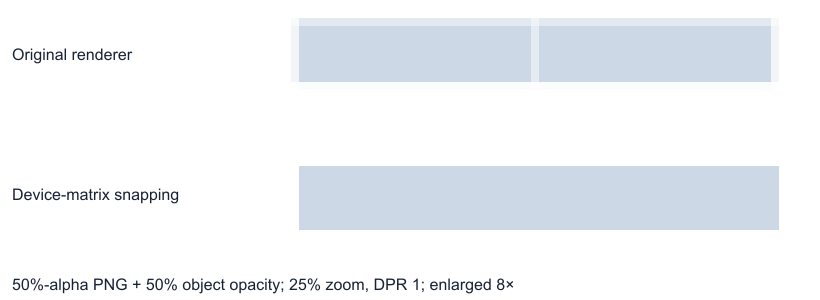

# Render-only pixel snapping: visual and performance experiment

Recorded 2026-10-13 on `chatgpt/frame-gap-investigation`, based on
`b496bd5118d5cd92b9765e1125c794af2d606680`. This is a diagnostic prototype, not a
production rendering change. The yellow-border PR is unaffected.

## Finding

Snapping can eliminate the tested seams, including transparent images, but
simply rounding model-derived edges and converting them back into the existing
local CSS boxes does not work reliably. Browser layout quantization leaves small
residual gaps and antialiased edges.

The successful prototype paints frame boxes in integer device-pixel units and
uses a reciprocal-DPR transform matrix to place their visual surface. This keeps
the four edges in one coordinate space through painting. It uses the existing
SlideRenderer DOM and native fills/media, without combining objects or using
WebGL. Original document objects are checked for mutation after every fixture.

It passes 1,152 opaque/translucent fill cases and 576 uniform-alpha PNG cases with
zero seam pixel differences. That is evidence for the approach, not a completed
integration for text, nested transforms, video, effects, or arbitrary media rules.

## Visual measurements

Each fill variant has 1,152 cases: ordinary rectangles and clipped empty frames,
widths 120/120.3, four fractional positions, object opacity 1/0.5, nine zooms
25–200%, and DPR 1/1.25/1.5/2. The image matrix has 576 cases per variant and uses
an actual loaded PNG with uniform 50% pixel alpha, plus object opacity 1/0.5.
The image prototype also adapts the simple Fill content box to the snapped frame.

| Fill painting variant                        | Seam difference above 2 RGB levels | Maximum join gap (device pixels) |
| -------------------------------------------- | ---------------------------------: | -------------------------------: |
| Existing renderer                            |                        840 / 1,152 |                         0.000008 |
| Snap edges, convert back to local CSS        |                        872 / 1,152 |                         0.046875 |
| Same, with neutral frame transform removed   |                        872 / 1,152 |                         0.046875 |
| Snap local boxes with CSS zoom               |                        432 / 1,152 |                         0.023438 |
| Device-unit boxes with reciprocal CSS zoom   |                        432 / 1,152 |                         0.023438 |
| Device-unit boxes with reciprocal-DPR matrix |                      **0 / 1,152** |                         0.000009 |

The successful matrix variant has **zero exact pixel differences**, not merely
differences below the two-level reporting threshold. DOM bounds have residual
floating measurement error up to 0.000061 device pixels.

For PNGs, existing rendering has 420 of 576 cases above two levels, whereas the
device-matrix variant has zero exact differences in all 576. No page errors were
reported. Uniform image content intentionally allows comparison with interior
pixels: this is an alpha/edge test, not a test of texture fidelity, crop anchors,
Free positioning, or image aspect-ratio behavior.

The largest measured edge displacement relative to the original rendered DOM was
**0.515625 device pixels**. Ideal round-to-nearest math moves an edge by at most
0.5 pixels; the small excess reflects original CSS layout quantization and
measurement precision. Width/height can change by nearly one device pixel because
their two edges move independently. An integer shared edge is computed identically
for both neighbors rather than rounding widths separately.

### Thin elements and movement

The separate 19,600-case arithmetic sweep verified a theoretical maximum edge
shift of 0.5 device pixels, maximum observed width change of 0.975 pixels, and
shared-edge discrepancy below floating-point noise (4.45e-15 pixels).

Subpixel elements can collapse to zero rendered width. Across 2,800 phase/zoom/DPR
combinations per logical width, one-unit rectangles collapsed in 745 cases;
two-unit rectangles in 398; five-unit rectangles in 113. Widths 10 and 120 did not
collapse in this sweep. These proportions describe this chosen sweep, not expected
real-world frequencies. At DPR 1 and 25% zoom, a one-unit width is only 0.25 device
pixels before snapping.

A production implementation needs an eligibility policy for small elements.
Clamping every collapsed element to one pixel could introduce overlap and is not
a tested solution. Pan, zoom, and dragging may also make geometry advance in
one-device-pixel steps. Quantization must stay out of saved geometry, hit testing,
snapping calculations, and history.

## Performance method

The measurements distinguish arithmetic from DOM updates:

1. Node runs the same edge-rounding helper on 100/1,000/10,000 rectangles. Warmup,
   batches, and a consumed checksum prevent timing a cold or unused calculation.
2. A native browser scene compares baseline, local snapping, and device-matrix
   snapping at 100/1,000/5,000 rectangles. All rectangles fit within the viewport.
   Pan changes the common origin; a single-element edit changes one box.
3. Three repetitions alternate mode order. Each has 20 warmup and 90 measured
   requestAnimationFrame updates. JS/style-write time, forced layout time, frame
   interval, and intervals above 25 ms are recorded separately.

The browser benchmark is synthetic DOM, **not the full ShowMe React renderer**.
It does not measure GPU paint time separately, real effects, image decoding,
memory growth, high-refresh displays, or Electron. Frame intervals include paint
and scheduling but cannot isolate GPU cost. No per-element layout reads are mixed
with style writes; known view geometry is reused. The arithmetic benchmark does
not include scene traversal or transform composition.

Host: Windows, Intel Core i9-9900K (16 logical CPUs), Node v24.4.1, headless Chromium
153.0.8010.12, browser benchmark DPR 1.25. These are observations on one machine,
not CI thresholds or performance guarantees. Earlier mixed-workload timing runs
were exploratory; the recorded final performance run was executed without another
browser experiment running.

### Final timing observations

Pure helper cost (median and p95 per batch of rectangles):

| Rectangles |     Median |        p95 |
| ---------- | ---------: | ---------: |
| 100        | 0.00485 ms | 0.01557 ms |
| 1,000      | 0.03613 ms | 0.06624 ms |
| 10,000     | 0.34709 ms | 0.55097 ms |

Synthetic whole-scene pan, comparing baseline with the successful device-coordinate
technique. Values are medians of the three per-run medians; JS and layout columns
are separate measurements, not total frame rendering time:

| Rectangles | Baseline JS / layout | Snapped JS / layout | Baseline / snapped frame interval |
| ---------- | -------------------: | ------------------: | --------------------------------: |
| 100        |         0.0 / 0.1 ms |        0.2 / 0.2 ms |                    16.7 / 16.7 ms |
| 1,000      |         0.0 / 0.1 ms |        2.0 / 1.4 ms |                    16.7 / 16.7 ms |
| 5,000      |         0.0 / 0.2 ms |        8.7 / 6.9 ms |                    16.7 / 33.2 ms |

At 5,000 boxes, the device-coordinate variant had 144 of 270 frame intervals above
25 ms; baseline had zero. At 1,000 and 100, neither had intervals above 25 ms.
For a single-element edit, both retained 16.7 ms median frame intervals and zero
intervals above 25 ms at all three counts; the extra arithmetic was below the
browser timing resolution in most samples. Zero reported JS time means below
timing resolution, not zero work.



Measured tables and summary are retained in [pixel-snap-results.json](pixel-snap-results.json).
The important cost is updating a whole slide during pan/zoom rather than four
rounding operations. Updating only a changed element is much cheaper. A viable
integration needs cached world transforms, eligibility checks, batched geometry
reads, and dirty rendering updates; those optimizations were not implemented here.

## Reproduction

From the repository root, start Vite in a separate terminal:

```powershell
npx playwright install chromium
npm run dev -- --port 5187 --strictPort
```

Then run:

```powershell
node docs/investigations/frame-seams/pixel-snap-experiment.mjs
node docs/investigations/frame-seams/pixel-snap-experiment.mjs snap-device-units
node docs/investigations/frame-seams/pixel-snap-experiment.mjs snap-device-matrix
node docs/investigations/frame-seams/pixel-snap-experiment.mjs baseline images
node docs/investigations/frame-seams/pixel-snap-experiment.mjs snap-device-matrix images
node docs/investigations/frame-seams/pixel-snap-geometry.mjs
node docs/investigations/frame-seams/pixel-snap-perf.mjs
```

Run the performance script alone, after visual experiments complete. Detailed
measurements and screenshots are written under ignored `test-results-pixel-snap/`.
Each visual fixture is freshly mounted, including opacity changes, so imperative
paint overrides cannot leak between cases. These are manual investigation scripts,
not registered product tests.

The retained documents, authority, persistence, editor interaction paths, and
production paint code remain unchanged. No runtime pixel-snapping feature is
enabled. Product suites, lint, typecheck, Electron, exports, nested/mirrored/
rotated-frame integration, fonts, effects, and motion verification were not run.

All visual scripts exited successfully with zero page errors; serialized document
checks passed. The geometry sweep assertions passed. The comparison/summary
generation asserted zero exact differences in the successful 1,152-fill and
576-image matrices. `node --check` passed for all four retained scripts, and
Prettier and `git diff --check` passed for this change. Runtime benchmarks have no
performance pass/fail thresholds.

The Vite server also logged `Target container is not a DOM element` during
experiment runs. These synthetic fixtures replace the application body, and the
trace points to the normal entrypoint trying to mount its original root. The
captured page-error arrays were empty, but server logs were not error-free; this
is not log-clean verification of the production editor. The fixture startup
logging was not investigated further for these diagnostic-only changes.
