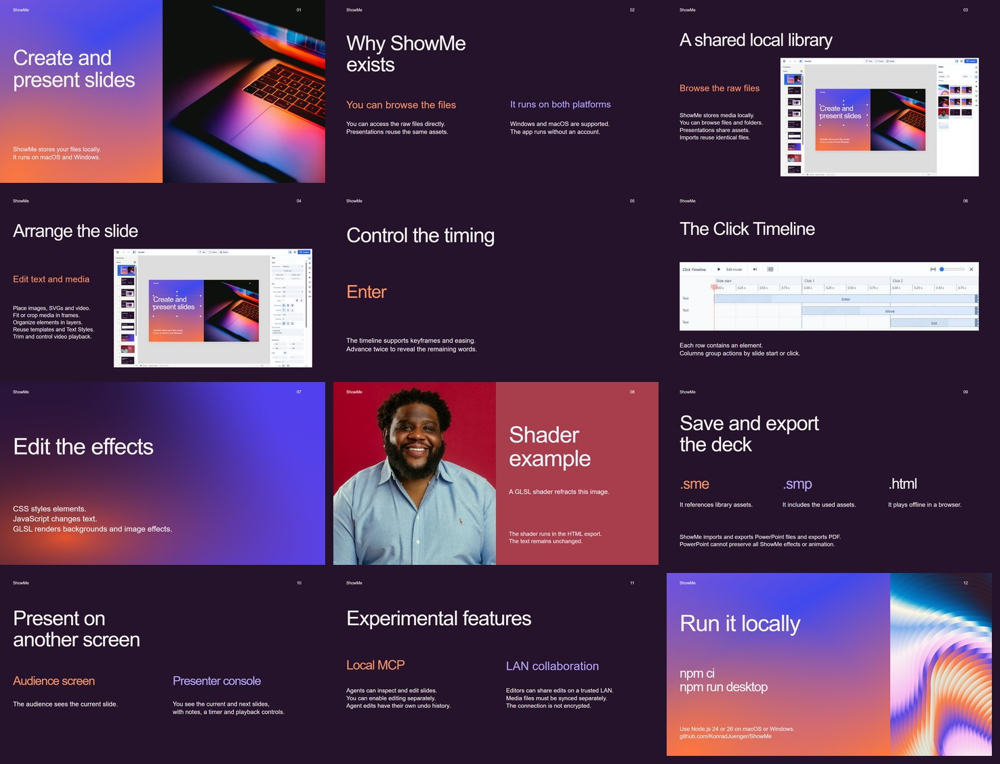

# ShowMe feature presentation

- [Standalone HTML](../docs/showme.html): player, slides and assets in one file.
- [Editable portable deck](showme.smp): open in ShowMe to inspect or change it.

The deck covers shared assets, slide editing, animation, CSS/JavaScript/GLSL
effects, presenting, file formats, MCP and collaboration. It includes actual
screenshots of the editor, media library and Click Timeline. Screenshots are
embedded assets, so they work offline too.

## Playback

Download the HTML and open it in a browser. Click the slide, or use the right
arrow or Space, to advance. The left arrow goes back; F toggles fullscreen.
The animation slide has two additional click steps before the next slide.
The shader slides need a browser with WebGL2 support.

The HTML includes its player and assets and works offline.

## Credits

Photos and artwork, under the [Unsplash License](https://unsplash.com/license):

- [MacBook Pro turned on](https://unsplash.com/photos/macbook-pro-turned-on-Bd7gNnWJBkU), Andras Vas.
- [Abstract swirling gradient](https://unsplash.com/photos/abstract-swirling-gradient-of-blue-pink-and-orange-colors-qTZr2TEUNBo), Andrei Castanha. The source description credits “Gradient by Jaquieu.”
- [A man with a beard and a blue shirt](https://unsplash.com/photos/a-man-with-a-beard-and-a-blue-shirt-pbcJrmcLX80), Romello Morris. 
